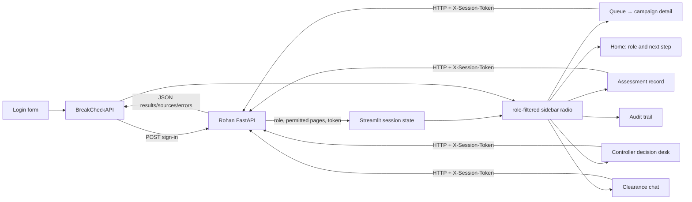
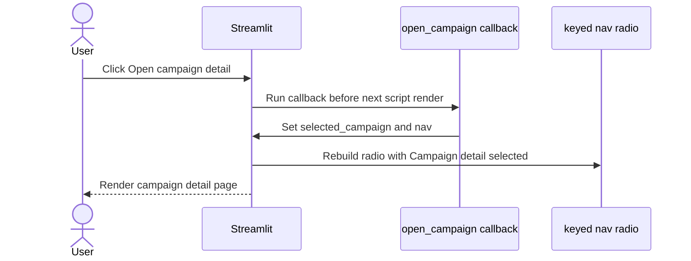

# Avinash's Wednesday–Friday Study and Presentation Guide

**Audience:** Avinash and teammates who need to understand the Streamlit pages and how they connect to the service.

**Purpose:** explain each Avinash-owned file in `5 day war.md`, the navigation fix, the role-based user journey, and where the API/data/assistant results enter the UI.

**Study window:** Wednesday 11 November through Friday 13 November 2026 (IST).

**Use with:** `Project/docs/FRONTEND_MANUAL_TESTS.md` and the API docs.

> This describes the current source snapshot. Confirm the actual branch diff and live API behavior before describing an interaction as complete.

## 1. Avinash's part in one sentence

Avinash turns authenticated API responses into a role-aware workspace: a user signs in, sees only relevant pages, follows an understandable next step, and can inspect queue/detail/assessment/decision/audit/chat information.

The browser/dashboard is a client. It should not secretly recalculate spot rules, make policy decisions, or claim a campaign is cleared when the API has not recorded a Controller decision.



## 2. Monday–Friday story for the dashboard

- **Monday:** Karthiga's data files make stable facts available. The dashboard should display the API's returned units and labels; it should not clean or train data itself.
- **Tuesday:** Rohan and domain owners agree on route/JSON fields. Avinash connects controls to those paths and handles loading/errors.
- **Wednesday:** explain user roles, login, session state, page filtering, button callbacks, and one full user journey.
- **Thursday:** trace each screen to its API path and show the correct owner behind the data: Ronit for spot findings, Raghu for sources/assistant, Rohan for persistence/access.
- **Friday:** perform the manual click-through for every role, capture evidence, and label fake/placeholder API fields instead of presenting them as live calculations.

## 3. Exact files Avinash owns

### 3.1 App shell and page navigation

#### `Project/dashboard/clearance_queue.py`

This is the main Streamlit entry point despite the filename. It configures the page, applies theme helpers, defines page names, shows login if no auth session exists, or renders an authenticated workspace.

- Login sends credentials to `BreakCheckAPI.sign_in()` and stores returned identity/role/pages/token in `st.session_state.auth`.
- The sidebar builds an available page list from the backend-provided `pages` value.
- The navigation radio uses key `nav`.
- Before creating the radio, the app checks that `nav` is still a page this role may see.
- The selected page imports and calls its page module's `render(api)` function.
- A service error gets a user-facing API message; an unexpected exception gets a generic load message plus diagnostic caption.
- Sign-out calls the API, clears local auth and selected page references, then reruns.

**Security/design note:** the current login screen displays local demo usernames and passwords in an expander. That is acceptable only for a private local demo; remove or replace it with SME-approved credentials before a public/shared deployment.

#### `Project/dashboard/__init__.py`

Package marker/docstring. It allows the dashboard directory to be imported as a Python package. No page behavior belongs here.

#### `Project/dashboard/ui.py`

Shared rendering/navigation helpers:

- `open_campaign(reference)` stores selected campaign and changes `nav` to Campaign detail.
- `navigate_to(page)` changes the selected page.
- `apply_theme()`, `page_header()`, and `metric_card()` standardize visual elements.
- `api_error()` maps 401/403 to user-facing explanations.
- `dataframe()` handles empty data safely and displays selected columns.
- `status_label()` turns status constants into readable labels.

### 3.2 API client

#### `Project/dashboard/api_client.py`

`BreakCheckAPI` wraps `requests.Session`:

- `sign_in()` calls `/auth/sign-in` and stores the returned session token on that client instance.
- `_request()` adds `X-Session-Token`, applies a timeout, raises a readable `APIError` if the service cannot be reached or returns a non-success response, and parses JSON.
- `get()` and `post()` expose simple methods for page modules.
- `sign_out()` sends the sign-out route if a token exists.

The user does not manually paste a session token anywhere. The dashboard handles this handoff from sign-in to later requests.

### 3.3 Role-aware Home

#### `Project/dashboard/home.py`

Defines a `ROLE_GUIDES` entry for Controller, Executive, and Liaison. The page explains the role, agencies where applicable, available pages, four workflow steps, work summary, and an appropriate next action.

- A Controller with pending records gets a “Review pending decisions” action.
- An Executive with unassessed campaigns can select one and go to its detail page.
- A Liaison gets a path to clearance chat and sees assigned agencies.
- Other state gets a useful empty/completed-work message.

It fetches queue/assessment counts through the API; it does not read a local database itself.

### 3.4 Queue, campaign and assessment pages

#### `Project/dashboard/queue_page.py`

Calls `GET /queue`, filters rows by category and partial campaign reference, displays ordered facts, and offers a campaign selector. The **Open campaign detail** button uses the `open_campaign()` callback.

#### `Project/dashboard/campaign_detail.py`

Calls queue and detail endpoints for a selected campaign. It displays booked/flagged counts, exposure, amendment signal, spot-level breach codes, first transmission, issue signal, source code document, and open outcomes. A form submits an assessment request to `POST /assessments` and stores the returned assessment ID.

The page displays facts supplied by the API. If the API currently returns placeholder calculations, the UI cannot turn them into valid rule results by styling them.

#### `Project/dashboard/assessment_page.py`

Lists `/clearances`, filters by status, reads `/clearances/{id}`, and displays request/summary, recommendation, breaching spots, call metadata, and full result. This is the tracking view after assessment creation.

### 3.5 Decision, audit, and chat

#### `Project/dashboard/decision_queue.py`

Loads pending records, selects an assessment, shows the recommendation and spot facts, then sends the chosen allowed outcome and reason to the Controller decision endpoint. It asks the user to confirm they reviewed the case and enforces a local minimum reason length. The API still performs the authoritative role, opener, and state checks.

#### `Project/dashboard/audit_trail.py`

Provides Audit events and Chat activity tabs. It reads `/audit` and `/audit/chat-turns`, stringifies nested event details for tabular display, and shows recent actor/action/campaign/source/refusal facts.

#### `Project/dashboard/clearance_chat.py`

Shows prior turns, sources, and refusal explanations. It submits new text to `POST /chat/ask`, saves only a temporary notice about fallback generation mode in session state, and reruns so the server-persisted turn appears in the transcript.

**Talk track:** “The chat screen does not generate policy answers. It asks the API, then presents the answer, source filenames, and fallback/refusal state returned by Raghu's assistant and Rohan's route.”

### 3.6 Startup, tests, guide, and theme

#### `Project/run_dashboard.py`

Sets headless mode by default, changes to the `Project` directory, and starts Streamlit on `dashboard/clearance_queue.py`. It is the dashboard entry point called from `HOW_TO_RUN.md`.

#### `Project/tests/test_dashboard_navigation.py`

Uses Streamlit `AppTest` to click both “View campaign” and “Open campaign detail” callbacks and verify navigation updates `nav` plus selected campaign.

#### `Project/tests/test_home_page.py`

Tests each role with representative data, verifies the page renders without an exception, and expects a role-specific next-action button.

#### `Project/tests/test_clearance_chat_ui.py`

Tests the empty welcome/chat-input state, saved message/source rendering, and submitting a prompt through the API stub then rendering the returned turn.

#### `Project/docs/FRONTEND_MANUAL_TESTS.md`

Black-box checklist for a person using the app: Home per role, both campaign navigation buttons, detail selection, assessment, decision, audit, varied policy questions, sign-out/role switch, refusal, and Liaison agency scope. Keep expected results aligned with the actual API, not hardcoded assumptions.

#### `Project/.streamlit/config.toml`

Theme and Streamlit server/browser settings: color palette, fonts, corners, port, bind address, toolbar mode, and usage-statistics setting. It affects presentation/runtime defaults, not business permission.

## 4. Why the `nav` session-state error happened and why callback timing matters

Streamlit widgets with a key own that key after the widget is instantiated in a run. The old failing pattern was conceptually:

```python
selected = st.radio("WORKSPACE", pages, key="nav")
st.session_state.nav = "Campaign detail"  # too late in this run
```

The working pattern puts the change in a button callback. Streamlit runs the callback before rebuilding the page and creating the keyed radio again:

```python
def open_campaign(reference):
    st.session_state.selected_campaign = reference
    st.session_state.nav = "Campaign detail"

st.button(
    "Open campaign detail",
    on_click=open_campaign,
    args=(chosen_campaign,),
)
```

`clearance_queue.py` also checks/fixes an invalid role-specific `nav` value before creating the `st.radio(..., key="nav")` widget. The callback change and the pre-widget initialization are the important points. Do not set `nav` later in the same script after that radio exists.



## 5. Cross-team connections

| UI surface | API path | Data owner behind the API | What Avinash should display |
|---|---|---|---|
| Home and queue | `GET /queue`, `GET /clearances` | Ronit for checked facts; Karthiga for model signals; Rohan for role and JSON | counts, ordering, statuses, clear next action |
| Campaign detail | `GET /queue/{reference}`, `POST /assessments` | Ronit spot findings, Karthiga predictions, Raghu source code, Rohan persistence | per-spot evidence, units, available outcomes, assessment ID/status |
| Assessments | `/clearances`, `/clearances/{id}`, `.../calls` | Rohan records; Ronit workflow; domain owners' findings | status, recommendation, calls, reason, result |
| Decision desk | `/clearances?status_value=...`, `POST .../decision` | Rohan authorization/storage; Ronit allowed decisions/outcome | only API-provided choices; confirmation; recorded result |
| Audit trail | `/audit`, `/audit/chat-turns` | Rohan audit persistence; Raghu sources/refusal facts | actor, action, campaign, source names, refusal state |
| Clearance chat | `/chat/turns`, `/chat/ask` | Raghu retrieval/generation, Rohan memory/auth, Karthiga/Ronit only if facts need them | answer, source names, fallback/refusal indicator, safe transcript |

## 6. Known behavior to state accurately

1. The dashboard sends requests to the API. If a backend page returns placeholder fields, those are still placeholders even if a polished metric card displays them.
2. The inspected API queue/detail code uses simplified/static spot values rather than all of Ronit's checks and Karthiga's models. Check integration before telling an SME the figures are calculated by the complete rules/model pipeline.
3. `clearance_queue.py` currently displays local demo credentials. It is not appropriate for a shared/public deployment.
4. The API import currently attempts a database reset; Rohan must make startup safe before relying on records surviving restart.
5. `Project/.streamlit/config.toml` listens on port 8080 for the dashboard, while API defaults/documentation use another port. The API base address is configurable in the login sidebar; confirm the service port before demo.
6. The interface catches `APIError` and shows a generic load message for unexpected exceptions. During debugging, retain the detailed caption/log instead of swallowing the exception.

## 7. Wednesday-to-Friday presentation route

### Wednesday: 6–8 minute user journey

1. Sign in as an approved local role; show the name/role and role-appropriate Home step.
2. Switch among role accounts to show page availability and Liaison agency labels.
3. Open the queue, filter category/reference, click **Open campaign detail**, and point out the `nav` callback flow.
4. Show detail and start an assessment only on a fresh demo campaign.
5. As a different Controller, open the Decision desk and record an allowed outcome only if demo state is disposable.
6. Open audit, then ask a policy question and point to sources/refusal.
7. Hand off to Rohan/Raghu/Ronit/Karthiga to explain where each JSON field came from.

### Thursday: cross-owner integration check

For each visible number, name its server source: schedule tool, prediction tool, stored assessment, or chat retrieval. If the API response does not contain evidence for that field, mark it as a UI/API mismatch and assign it to the API/domain owner.

### Friday: finish with manual evidence

Follow every row in `FRONTEND_MANUAL_TESTS.md`, record role, page, click, result, and screenshot/test evidence. Include both campaign buttons and session expiry/permission outcomes. Do not rely on a successful page load as evidence that business calculations are correct.

## 8. Real diff worksheet

```text
File:
Which control/page changed:
Which endpoint does it call:
What exact fields does it read/write:
Which owner produces those fields:
Which AppTest/manual action proves the UI behavior:
```

```powershell
git diff -- Project/dashboard Project/run_dashboard.py
git diff -- Project/tests/test_dashboard_navigation.py Project/tests/test_home_page.py
git diff -- Project/tests/test_clearance_chat_ui.py Project/docs/FRONTEND_MANUAL_TESTS.md
git diff origin/main...HEAD -- Project/dashboard Project/run_dashboard.py Project/tests
```

## 9. Suggested commands and evidence

From the `Project` directory, start the dashboard while the API is running:

```powershell
python run_dashboard.py
```

The project guide documents the API at `http://127.0.0.1:8000` and Streamlit config sets dashboard port `8080`. Confirm the values match the current branch before demoing.

Focused UI tests:

```powershell
python -m pytest tests/test_dashboard_navigation.py tests/test_home_page.py tests/test_clearance_chat_ui.py -q
```

Full acceptance command:

```powershell
$env:BREAKCHECK_CHAT_OFFLINE = "1"
python -m pytest ..\pytest\tests.py tests -q
$pytestExitCode = $LASTEXITCODE
Remove-Item Env:BREAKCHECK_CHAT_OFFLINE
exit $pytestExitCode
```

Evidence checklist: role and available pages; callback click; selected campaign reference; API status/response; assessment ID; controller gate; audit row; source names; no Streamlit exception. Do not place tokens or passwords in screenshots.

## 10. Questions Avinash may be asked

**Why not set the radio key directly after the button?** Because the keyed widget owns that session-state key after construction; use a callback which runs before the next rerun, or initialize state before creating the widget.

**How does the dashboard know which pages to show?** It uses the `pages` returned at sign-in and filters the sidebar choices. The API still enforces access on every request.

**Does hiding a page secure the API?** No. The UI is only navigation; Rohan's server-side role checks are authoritative.

**Does chat retrieve documents inside Streamlit?** No. It posts the question to the API, then displays the returned answer and sources.

**What if an API call fails?** `APIError` is shown with a 401/403-specific message or the service error; unexpected render failures show a generic page message and diagnostic caption.

**Are dashboard numbers necessarily real model outputs?** Only if the API actually wired Karthiga's model and Ronit's calculation path and the response has been verified. A label or attractive card cannot validate the source.

## 11. One-minute summary

“My work is the user-facing Streamlit client. The API returns the user's role and available pages, and the dashboard uses those pages to guide each person through the work. It sends session-authenticated requests for queue, detail, assessment, decision, audit, and chat, then displays the returned fields and errors. Campaign buttons update navigation through callbacks before the keyed radio reruns, which fixes the session-state error. Rohan enforces access and saves results; Karthiga, Ronit, and Raghu provide the data, checks, and evidence behind those results.”
