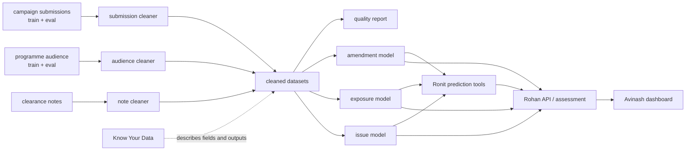
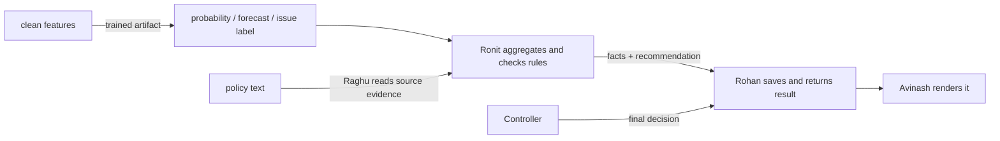

# Karthiga's Wednesday–Friday Study and Presentation Guide

**Audience:** Karthiga and teammates who need to understand the data and model boundary.

**Purpose:** explain every Karthiga-owned file listed in `5 day war.md`, show how the files form one reproducible pipeline, and connect the outputs to Raghu, Ronit, Rohan, and Avinash.

**Study window:** Wednesday 11 November through Friday 13 November 2026 (IST).

**Use:** study this guide with `Project/docs/Know_Your_Data.md`; refresh any counts after the source CSVs change.

> This guide describes the inspected repository snapshot. New work that is pasted after this guide is written must be compared to its real Git diff before it is presented as completed behavior.

## 1. Karthiga's part in the application

Karthiga prepares consistent historical data and trains three prediction models. Her output is an input to other owners; it is not a final clearance decision.



### Monday–Friday story

- **Monday:** Karthiga reported the cleaning pipeline files and `Project/tests.py` as pushed. The repository snapshot shows the seven cleaning modules and runner, but `Project/tests.py` is currently empty; the acceptance suite lives at `pytest/tests.py`. Verify what “tests.py” was intended to contain before presenting it as evidence of a passing suite.
- **Tuesday:** confirm exact ownership and model interfaces; do not repaste Monday's modules unchanged.
- **Wednesday:** explain raw inputs → cleaning → quality profile → feature schema → train/evaluate/save.
- **Thursday:** explain how Ronit reads prediction outputs and how Rohan should expose only real predictions and their units.
- **Friday:** show reproducible commands and evidence; state what is measured, what is not measured, and which outputs are generated locally.

## 2. The five historical data inputs

These are the model/pipeline inputs. They are different from Ronit's four live campaign files under `Project/data/input/`.

| Exact file | Contents and target |
|---|---|
| `Project/data/campaign_submissions_train.csv` | Historical submissions; target `amendment_required` (Yes/No) |
| `Project/data/campaign_submissions_eval.csv` | Supplied held-out submissions; same target, used to measure amendment performance |
| `Project/data/programme_audiences_train.csv` | Programme/schedule and audience history; target `under18_viewers` (in thousands) |
| `Project/data/programme_audiences_eval.csv` | Supplied held-out schedule/audience records; same target, used to measure exposure performance |
| `Project/data/clearance_notes.csv` | Past notes; target `issue_category` (one of the configured issue labels) |

The supplied train/eval files are already split. Do not shuffle rows between them or use the evaluation target as a model feature. Notes have no separate note evaluation CSV in the current project.

## 3. File-by-file guide: Monday cleaning work

### `Project/data_pipeline/dataset_loader.py`

Reads the raw CSV as strings and keeps blank fields explicit (`dtype=str`, `keep_default_na=False`). This avoids Pandas silently converting identifiers, categories, or special missing tokens before the cleaning rules see them.

**Talk track:** “The loader preserves the source representation so the next step can apply the project's own rules.”

### `Project/data_pipeline/__init__.py`

Package marker for the data-cleaning modules. It allows consistent `data_pipeline...` imports from the project runners; it contains no cleaning rule by itself.

### `Project/data_pipeline/common_cleaning.py`

Reusable helpers used by all cleaners:

- `_text` trims safe text and handles missing values.
- `normalise_values` maps aliases such as yes/no or category spellings using config dictionaries.
- `parse_number` accepts only the configured numeric pattern and returns a missing value for known null tokens.
- `clean_numeric` parses selected columns and changes out-of-range readings to missing.
- `deduplicate_and_require_target` keeps answered target rows and one record per ID.
- `write_frame` creates the output directory and writes the cleaned CSV.

**Explain the design:** raw data is not silently “fixed” into an invented number. Recognized values become standard values; impossible/out-of-range facts become missing or cause a clear parsing error.

### `Project/data_pipeline/submission_cleaning.py`

Processes campaign submission rows. It normalizes configured text labels, reads clock-number spot lengths and written durations, parses numeric fields, and removes contradictory values such as legal-text length exceeding copy length. When a valid standard clock number supplies the spot length, that duration takes precedence. It then removes duplicate submission IDs and rows with no amendment target.

### `Project/data_pipeline/audience_cleaning.py`

Processes schedule/audience observations. It normalizes fields and audience units, converts viewer counts to thousands, validates configured ranges, and handles calendar clocks versus broadcast clocks. Calendar times before the broadcast-day start are attributed to the previous weekday and rolled past midnight. Invalid target values are excluded.

### `Project/data_pipeline/note_cleaning.py`

Processes clearance notes. It decodes HTML entities, removes markup, collapses whitespace, lowercases text, canonicalizes the note timestamp, recalculates text length, and removes short notes, duplicate IDs, or missing issue labels.

### `Project/data_pipeline/quality_profiler.py`

Returns a report for a raw/clean pair: received/kept/removed rows, duplicate/missing-target counts, column count, and missing cells before/after. The runner adds dataset-specific contradiction counts.

**Important explanation:** the report is evidence about a particular run and its input snapshot; it is not a guarantee that all remaining feature cells are complete. Missing feature values are allowed and the model pipeline imputes them.

### `Project/data_pipeline/feature_builder.py`

- `add_slot_minutes()` derives start minute and duration from normalized start/end times.
- `build_feature_frame()` emits only the requested feature columns in the caller's order, coercing numeric values and preserving missing categorical values.

The explicit order matters because the persisted feature schema is the contract between training and prediction.

### `Project/run_data_pipeline.py`

Orchestrates five cleaning jobs: submissions train/eval, audiences train/eval, and notes. For each it loads raw data, writes the cleaner's output, profiles the result, adds relevant defect counts, and writes `output/data_quality_report.json`.

It does **not** train models. Model training is a separate command so data preparation and model fitting can be inspected independently.

### `Project/tests.py`

This path is listed as a Monday push. In the inspected checkout it is **zero bytes**. Do not say it contains the pipeline's tests. The project-wide acceptance tests are in `pytest/tests.py`; use them without editing the acceptance contract. If Karthiga adds focused tests, use a clear file such as `Project/tests/test_data_pipeline.py` rather than leaving a blank file described as test coverage.

## 4. File-by-file guide: model work

### `Project/modeling/_common.py`

Shared feature and estimator construction:

- `frame_with_features()` adds absent expected fields, orders columns, converts numeric values, and preserves gaps.
- The numeric preprocessor fills missing values with a median and adds missingness indicators.
- The categorical preprocessor fills missing categories with a marker and one-hot encodes unknown-safe categories.
- `classifier()` uses logistic regression when there is more than one target class and a most-common-class fallback otherwise.
- `regressor()` uses a 150-tree random forest for multiple rows and a mean fallback for a single row.

**Explain why it is shared:** training and prediction must apply identical preprocessing to the same named features.

### `Project/modeling/amendment_model.py`

Trains a Yes/No classifier for whether a submission requires amendment. It maps the target using configuration, excludes rows without a usable target, fits the configured numeric/categorical features, and attaches the feature schema. Prediction functions return a class or the positive-class probability; the probability is the score that should later be converted to a configured band.

### `Project/modeling/exposure_model.py`

Trains a regressor for under-18 audience exposure. The result's unit is thousands, following the cleaning contract. At prediction time it selects only the named features and returns numerical estimates.

### `Project/modeling/issue_model.py`

Trains a note-text classifier using TF-IDF one- and two-word phrases followed by balanced logistic regression. If the training labels contain one class, it uses a most-common-class fallback. It predicts issue labels; it does not itself decide which issue is legally present. Ronit's `build_issue_facts()` aggregates several note predictions with source weights.

### `Project/modeling/model_evaluation.py`

Computes classification metrics (accuracy, precision, recall, F1, ROC AUC, and generalization gap), regression metrics (R², MAE, RMSE, baseline MAE, and gap), and text-classification macro-F1/per-class metrics.

**Current evaluation limitation:** `run_model_training.py` currently writes amendment and exposure evaluation metrics only. It trains the issue model but does not calculate a held-out issue score because there is no supplied note eval file. Do not claim that the runner reports an issue-model test score.

### `Project/modeling/model_registry.py`

Saves/loads scikit-learn estimators with joblib, JSON schemas, and metric reports. `load_feature_schema()` supports both a plain list and older dictionary formats. The `.pkl` files are generated artifacts; regenerate them from source data instead of committing them.

### `Project/run_model_training.py`

Reads the cleaned files (and can fall back to raw configured paths), fits all three models, evaluates amendment and exposure on their supplied eval datasets, saves model files/schema/metrics, then reloads the serialized amendment artifact before final scoring.

**Training detail to disclose:** the amendment model is trained on the first 6,000 cleaned training rows in the current code. Exposure uses the full cleaned audience train set; issue classification uses the cleaned note set. Explain this if asked about representativeness.

### `Project/docs/Know_Your_Data.md`

Human-readable record of the five input files, cleaning rules, row/missing counts, output names, targets, model algorithms, and rebuild commands. It says its counts are snapshots. Re-run the cleaning report and update the document whenever source data or cleaning logic changes.

### `Project/tests/test_modeling.py` (new focused test file, if created)

Use it for focused model tests such as exact feature schema, missing/unseen values, prediction shape, target leakage, class vocabulary, and metric artifact consistency. The current file does not exist, so only list it as a new file if Karthiga actually creates it.

## 5. Model training path in one code example

Simplified from the actual training runner:

```python
submissions = _read(clean_submissions_train, raw_submissions_train)
audiences = add_slot_minutes(_read(clean_audiences_train, raw_audiences_train))
notes = _read(clean_notes, raw_notes)

amendment = train_amendment_model(submissions)
exposure = train_exposure_model(audiences)
issue = train_issue_model(notes)

save_model(amendment, amendment_model_path)
save_model(exposure, exposure_model_path)
save_model(issue, issue_model_path)
save_metrics(metrics, metrics_path)
```

The important sequence is **clean → build named features → fit → evaluate on held-out data where available → save reproducible artifacts**.

## 6. Where other owners join Karthiga's work

| Consumer | Data Karthiga should provide | How it enters |
|---|---|---|
| Ronit | amendment probability, exposure estimate, issue probabilities/schema | `Project/tools/prediction_tools.py`; Ronit combines them with notes/spot rules |
| Rohan | stable fields, units, feature schema, persisted outputs, and honest missing/error behavior | service route/repository; current route code must be wired to the tools instead of fabricating score values |
| Raghu | not the trained models; Raghu uses policy documents for normative answers | retrieval and answer sources stay separate from learned predictions |
| Avinash | display-ready score/band/unit and a plain explanation of what it means | dashboard shows API fields; it should not recompute or guess the model score |

Keep the distinction clear:

- **Model estimate:** learned from historical examples, with uncertainty and metrics.
- **Rule check:** deterministic interpretation of a written policy and schedule.
- **Human decision:** the Controller's accountable choice.



## 7. What not to claim yet

1. A model score is not a legal ruling or controller decision.
2. `issue_model.py` classifies historical note text; it does not know the authoritative code rule.
3. The current API queue path has shortcuts and does not yet call all Karthiga prediction tools. A model file existing on disk does not prove the service uses it.
4. The model runner does not currently report held-out issue-model metrics.
5. `Project/tests.py` is empty in the inspected snapshot; the full acceptance contract is `pytest/tests.py`.
6. Do not commit trained `.pkl`, generated `processed/` CSVs, reports, caches, or `__pycache__`; show reproducible command output instead.

## 8. Suggested Wednesday explanation (7–9 minutes)

1. Point to the five input files and explain train versus eval.
2. Walk from `dataset_loader.py` to one domain cleaner and the shared helper.
3. Show `run_data_pipeline.py` and the report's row counts/defect counts.
4. Explain why `feature_builder.py` and saved schema order prevent training/inference mismatch.
5. Compare the amendment classifier, audience regressor, and note issue classifier in ordinary language.
6. Show how `run_model_training.py` saves models and evaluates the held-out amendment/audience sets.
7. Pass the story to Ronit: “Here are the outputs your prediction tools consume; here are their units.”
8. Pass it to Rohan/Avinash: “The API should return these actual outputs, and the dashboard should display them without inventing values.”
9. Name gaps honestly: the issue eval score and live API wiring still need evidence.

## 9. Diff worksheet and commands

Fill this from the real branch diff before presenting a changed file:

```text
File:
Old behavior (from the base revision):
New behavior (from this revision):
Why this change matters:
Who consumes it next:
Evidence from a test/report:
```

```powershell
git diff -- Project/data_pipeline
git diff -- Project/modeling Project/run_model_training.py
git diff -- Project/docs/Know_Your_Data.md
git diff origin/main...HEAD -- Project/data_pipeline Project/modeling Project/run_model_training.py
```

If the file has no diff, call it an existing dependency, not new work.

## 10. Rebuild and evidence commands

Run these from `Project` when the team is ready. They create local generated outputs; do not stage those outputs.

```powershell
python run_data_pipeline.py
python run_model_training.py
```

Expected output locations:

- `Project/processed/*_clean.csv`
- `Project/output/data_quality_report.json`
- `Project/output/models/*.pkl`
- `Project/output/models/*_features.json`
- `Project/output/model_metrics.json`

Evidence to record: input file/version, pipeline exit code, rows kept/removed, generated schema feature lists, metrics for amendment/exposure, model output location, and any issue-model limitation. Do not say a metric “passed” until the documented threshold and actual run result are visible.

Acceptance command from the `Project` directory:

```powershell
$env:BREAKCHECK_CHAT_OFFLINE = "1"
python -m pytest ..\pytest\tests.py tests -q
$pytestExitCode = $LASTEXITCODE
Remove-Item Env:BREAKCHECK_CHAT_OFFLINE
exit $pytestExitCode
```

## 11. Teammate questions Karthiga may get

**Why read raw values as text?** So IDs, null markers, units, and date/time formats remain intact until explicit rules handle them.

**Why leave some feature values missing?** A missing feature is different from a false value. The model pipeline imputes numeric and categorical gaps with explicit behavior.

**Why separate evaluation files?** They are held out from fitting so we can measure predictions on records not used to train the model.

**Why keep both models and schemas?** The model needs the same named, ordered features at inference that it saw at training.

**Which model chooses clear/reject?** None. Models estimate risk signals; a human Controller makes the final clearance decision.

**Is the application already using the saved models?** The intended caller is Ronit's prediction tools, then Rohan's service. The inspected API code still has shortcuts; show wiring/tests before claiming it is fully connected.

## 12. One-minute summary

“My work turns five supplied datasets into consistent, measured inputs. The cleaners preserve raw sources, standardize known values, flag contradictions, and report what changed. Three models estimate amendment likelihood, audience exposure, and note issue type. The feature schemas keep prediction aligned with training. Ronit should combine those signals with deterministic schedule rules; Rohan should return and save the actual results; Avinash should explain them in the dashboard. A model is evidence, never the final Controller decision.”
