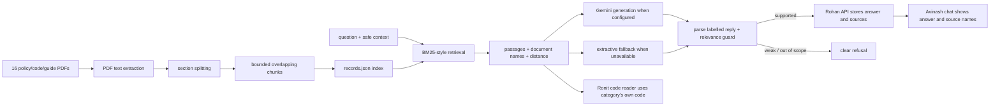
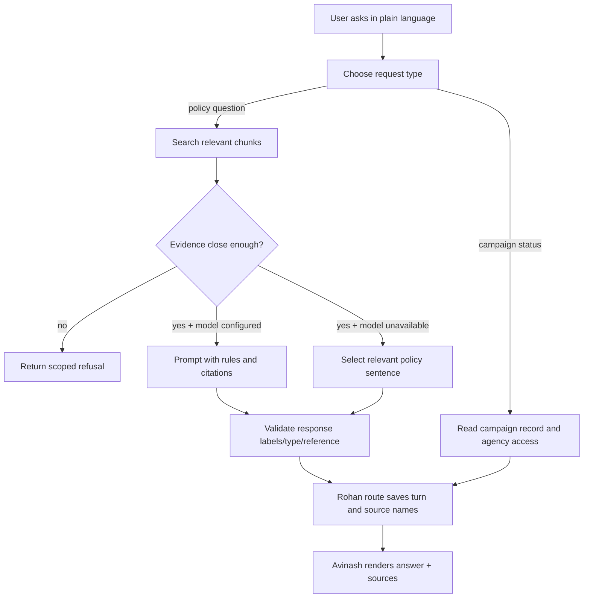

# Raghu's Wednesday–Friday Study and Presentation Guide

**Audience:** Raghu and teammates who need to understand policy retrieval, source evidence, and assistant answers.

**Purpose:** explain every Raghu-owned path in `5 day war.md`, show the journey from policy PDF to answer, and clarify how retrieval connects to the rules engine, API, and dashboard.

**Study window:** Wednesday 11 November through Friday 13 November 2026 (IST).

**Study with:** `Project/docs/unit_testing.md` and the 16 source documents under `Project/data/docs/`.

> The descriptions below reflect the inspected source snapshot. After new commits, use real diffs and live answers to confirm which behavior is current.

## 1. What Raghu owns

Raghu's part makes approved written guidance usable by the application. The pipeline extracts text from PDFs, splits documents into small passages, stores passages with source names, retrieves relevant evidence, and produces an answer or a refusal. Raghu also supports Ronit's code-rule reader and the user-facing clearance assistant.

The assistant must not confuse these sources:

- **Written policy:** retrieved from the PDF corpus and cited by document name.
- **Campaign facts/status:** looked up from campaign/assessment records under access rules.
- **Prediction:** supplied by Karthiga's model; it is not a policy source.
- **Final decision:** recorded by a Controller; the assistant cannot make it.



## 2. Monday–Friday team story

- **Monday:** Karthiga's clean data pipeline establishes consistent campaign/audience/note fields. Raghu's source corpus is separate: raw PDFs are normative evidence, not training rows.
- **Tuesday:** agree on the interface: query text in, evidence/answer/source names/refusal flag out. Keep retrieved policy separate from campaign-status data.
- **Wednesday:** teach extraction → sections → chunks → index → search → grounded answer/refusal.
- **Thursday:** trace shared use: Ronit reads category rules from the indexed code; Rohan authenticates and records chat; Avinash displays source names and fallback/refusal notices.
- **Friday:** present multiple different questions, inspect source attribution, ask a follow-up, try an unrelated question, and state limitations honestly.

## 3. Files Raghu owns, one by one

### 3.1 Source corpus (16 PDFs)

The PDFs are already in the repository; update/copy only a real revised source. Do not create a replacement or paste PDF text into Python.

| Exact file | How it is used |
|---|---|
| `Project/data/docs/Advertising-Clearance-Policy.pdf` | General clearance policy background |
| `Project/data/docs/Code-Alcohol.pdf` | Alcohol category's authoritative code |
| `Project/data/docs/Code-Betting-And-Gaming.pdf` | Betting/gaming code |
| `Project/data/docs/Code-Consumer-Credit.pdf` | Consumer-credit code |
| `Project/data/docs/Code-Less-Healthy-Food.pdf` | Less-healthy-food code |
| `Project/data/docs/Code-Medicines-And-Health.pdf` | Medicines/health code |
| `Project/data/docs/Guide-Alcohol-And-Social-Success.pdf` | Category issue guidance |
| `Project/data/docs/Guide-Appeal-To-Under-18s.pdf` | Issue guidance on under-18 appeal |
| `Project/data/docs/Guide-Comparative-Claims.pdf` | Comparative-claim guidance |
| `Project/data/docs/Guide-Environmental-Claims.pdf` | Environmental-claim guidance |
| `Project/data/docs/Guide-Financial-Promotions.pdf` | Financial-promotion guidance |
| `Project/data/docs/Guide-Gambling-Inducements.pdf` | Gambling-inducement guidance |
| `Project/data/docs/Guide-Health-Claims.pdf` | Health-claim guidance |
| `Project/data/docs/Guide-Price-And-Offer-Claims.pdf` | Price/offer guidance |
| `Project/data/docs/Past-Clearances-Casebook.pdf` | Past cases; excluded from public chat answers by configuration |
| `Project/data/docs/Scheduling-And-Audience-Rules.pdf` | Schedule/audience guidance |

The category code mapping in `Project/config/config.py` matters: a betting question should use the betting code, not borrow an alcohol figure. Keep each code isolated when extracting category facts.

### 3.2 Extraction, sectioning, and index

#### `Project/knowledge/pdf_extraction.py`

`extract_text_from_directory()` reads each PDF page with pypdf, strips control characters, and rejects a PDF/page with no extractable text. It returns records shaped like `{document_name, document_text}`. This is an intentional failure instead of silently indexing an empty scan.

#### `Project/knowledge/chunk_splitting.py`

- `split_documents_into_sections()` verifies a single expected document header and numbered sections, removes the header, and preserves section numbers.
- `_chunks()` breaks a long section at a nearby word/sentence boundary and overlaps neighboring passages so a rule at a boundary is less likely to be lost.
- `build_chunk_records()` gives each chunk a stable `document-section-index` ID and records its source filename.

#### `Project/knowledge/vector_index.py`

Despite the module name, the inspected index is a **local lexical/BM25-style ranker**, not a neural embedding database. It stores JSON records and scores token overlap with term frequency, inverse document frequency, and length normalization. This distinction matters when explaining what “retrieval” means.

- `_Collection.query()` ranks passages and returns text, metadata, IDs, and distance-like scores.
- `build_vector_index()` writes generated `records.json` locally and rejects duplicate chunk IDs.
- `open_vector_index()` loads the JSON index; if missing, it lazily extracts and indexes the configured PDFs.
- `search_documents()` retrieves top passages, excludes `Past-Clearances-Casebook.pdf`, and fetches more candidates if excluded results filled the first page.
- `read_document_chunks()` and `find_nearest_passage()` support full-code and document-specific rule lookup.

Do not commit the generated index/cache. Rebuild it from the versioned PDF sources.

#### `Project/knowledge/code_reading.py`

`read_category_code()` maps a category to its own code PDF, reads that document's chunks, extracts restricted hours/live-sport exception/children's rule/figures, and errors when the text is ambiguous. It returns the source document name, normalized values, and matching rule sentences for Ronit.

**Explain it like this:** “The rule engine does not use whichever code happens to rank first. It opens the configured code for the campaign category and validates that the required figures are unambiguous.”

#### `Project/run_knowledge_indexing.py`

**Current state:** this runner is zero bytes in the inspected checkout. The index currently builds lazily through `open_vector_index()` when the stored index file is missing. Before telling teammates to run `python run_knowledge_indexing.py`, either implement the explicit runner or update the run instructions to describe lazy indexing accurately.

### 3.3 Rule-retrieval tools

#### `Project/tools/retrieval_tools.py`

Offers document-scoped helper functions:

- `read_executive_checks(collection, issue)` uses the issue-to-guide mapping.
- `read_rebooking_steps(collection, issue)` reads the category's code document for the rebooking question.
- `read_standing_restrictions(collection, category)` reads standing restrictions from the category's code.

These are useful to Ronit's agents because they return a relevant passage from a selected document rather than asking the assistant to guess the source.

### 3.4 Chat and conversation memory

#### `Project/chat/clearance_assistant.py`

Core assistant path:

1. `classify_question()` or the configured model labels the question as code rules, scheduling rules, agency advice, campaign status, or out of scope.
2. `extract_campaign_reference()` reads a campaign-shaped reference when present.
3. The assistant retrieves evidence for both the literal question and safe conversation search text.
4. It builds a prompt with the five category codes and retrieved passages, instructing the model to stay inside supplied evidence and not invent campaign facts.
5. It asks the language-model adapter once; if unavailable, it selects an extractive answer from the applicable code/passages.
6. `_parse_reply()` validates labels/type/reference.
7. A relevance-distance guard refuses unsupported non-status answers.
8. It returns answer, question type, document names, closest distance, fallback/generation mode, and refusal state.

Actual-style snippet from the fallback boundary:

```python
try:
    generated = call_language_model(prompt, config.AGENT_NAME_CLEARANCE_ASSISTANT)
except LanguageModelUnavailable:
    generation_mode = "retrieval fallback"
    guessed_type = classify_question(question_text)
    guessed_reference = extract_campaign_reference(question_text)
    fallback_answer = (
        _extractive_answer(question_text, offered_passages, full_codes)
        if guessed_type in config.CHAT_ANSWERED_TYPES
        else "The service will look up the campaign record."
        if guessed_type == config.CHAT_TYPE_CAMPAIGN_STATUS
        else "none"
    )
    response_text = (
        f"QUESTION TYPE: {guessed_type}\n"
        f"CAMPAIGN REFERENCE: {guessed_reference or config.CHAT_NO_VALUE_REPLY}\n"
        "ANSWER: " + fallback_answer
    )
```

This is a simplified teaching excerpt of the actual branch structure. In a fallback, different questions should still choose different rule sentences where the PDF contains those rules. A fixed general alcohol response would be a failure.

#### `Project/chat/conversation_memory.py`

`recall_conversation()` loads only the signed-in username's last configured number of turns, returns recent context, and makes combined search text for a short follow-up. Campaign-status answer text is replaced with a safe placeholder before it enters model history, so private campaign facts are not fed into policy generation.

#### `Project/chat/campaign_status_answer.py`

Answers from the campaign/assessment record rather than policy retrieval. It checks the campaign exists and, for a Liaison, checks that the campaign's agency is assigned to that user. It returns a not-found-style answer for both unknown and unauthorized campaigns to avoid revealing which is which. Internal desk roles receive richer assessment detail; Liaisons receive limited status/decision/outcome information.

### 3.5 Grounding tests

#### `Project/tests/test_clearance_assistant.py`

The existing focused tests check that one generation request receives category-code context, offline retrieval answers distinct alcohol and betting questions from their respective codes, an unrelated question is refused, and Gemini REST transport sends the key in a header rather than the URL.

These tests are not the whole product acceptance suite. The larger contract remains `pytest/tests.py`; do not change its expected behavior simply to make implementation pass.

## 4. How retrieval and generation differ

Retrieval means **find source text**. Generation means **write a concise response using that source text**. The chat path can still do question-specific, retrieved excerpt answers when Gemini is unavailable.



**Distance:** smaller means closer in the local ranker's scale. `CHAT_MAX_RELEVANCE_DISTANCE` is the configured cutoff. A score is not proof by itself; the passage content/source must also support the answer.

## 5. Where other owners join Raghu's work

| Handoff | Raghu provides | Next owner consumes |
|---|---|---|
| To Ronit | `read_category_code()` facts and document-scoped passages | `Project/tools/schedule_tools.py` checks every placement against category-specific thresholds/rules |
| To Rohan | `answer_from_documents()` answer/type/sources/refusal and `answer_campaign_status()` record-backed answer | API routes add authentication, persist the chat turn, enforce request role, and return JSON |
| To Avinash | stable answer/source/refusal/generation-mode fields | chat UI displays the right answer and makes fallback/refusal visible |
| From Karthiga | no model needed to search law text; optional issue classification helps select issue guidance | never substitute a model prediction for source evidence |

## 6. Current limitations to say aloud

1. `run_knowledge_indexing.py` is empty in the inspected checkout; index creation currently happens lazily on first open if absent.
2. `vector_index.py` implements lexical BM25-style matching, not embeddings, although optional vector/embedding packages appear in requirements.
3. Chat answer generation uses Gemini only when configured/available; otherwise it uses an extractive retrieval fallback. Say which mode was actually used in the demo.
4. Code-rule answers include the five category code names in the `source_documents` list under current behavior. Explain that this is the source reporting implementation and show the supporting answer; do not imply every listed code supplied the same rule.
5. Campaign-status questions are answered by record lookup and agency checks, not by the PDF search engine.
6. `Past-Clearances-Casebook.pdf` is excluded from assistant answer sources by configuration.
7. Current route startup has a database-reset issue documented in Rohan's guide; it can affect conversation/assessment persistence.
8. Generated `records.json` and vector/cache directories are local generated artifacts, not source files for Git.

## 7. Good question demonstration set

Use several unrelated questions, and pick the category/question wording based on the actual PDF sentence. The point is to see varied evidence, not to memorize one reply.

1. “What does the alcohol code say about its daily limit?”
2. “How far apart must betting and gaming spots be?”
3. “When does the live-sport exception apply?”
4. “How is a withdrawn spot re-booked?”
5. “Where is campaign `<valid reference>` in the clearance process?” (use a campaign assigned to the Liaison if demonstrating a Liaison)
6. “What is the capital of France?” (expected scoped refusal)

For each reply, record: request type, answer fact, source document, refusal flag, generation mode, and whether the statement matches the source passage. Do not expose a session token in a slide/screenshot.

## 8. Wednesday-to-Friday explanation order

### Wednesday: 6–8 minute walkthrough

1. Show one source PDF and explain extraction.
2. Show section/chunk records and why each carries a filename/ID.
3. Explain BM25-style retrieval versus answer generation.
4. Ask two different category questions and show the relevant sources.
5. Ask an unrelated question and show refusal.
6. Explain how campaign status uses the saved record and agency check instead of PDF retrieval.
7. Pass to Ronit: explain that the code reader returns deterministic rule facts for every spot; pass to Rohan/Avinash: show the API response contract and source UI.

### Thursday: integration rehearsal

Trace: PDF → `read_category_code()` → Ronit `check_campaign_spots()` → API assessment result → dashboard spot facts. If the API still emits placeholder spot results, stop and label the gap instead of saying the integration is complete.

### Friday: evidence and handoff

Re-index from clean source PDFs, compare at least five distinct questions, inspect source names/refusal behavior, check follow-up memory, and provide commit/test evidence. Note any retrieval miss by question text and source page/section for correction.

## 9. Real diff worksheet

For each actual changed file, complete:

```text
File:
Before (from the base branch):
After (from this commit):
Why the change improves extraction/retrieval/grounding:
Which caller uses this output:
Question/test that proves it:
```

```powershell
git diff -- Project/knowledge
git diff -- Project/chat Project/tools/retrieval_tools.py
git diff -- Project/data/docs
git diff origin/main...HEAD -- Project/knowledge Project/chat Project/tools/retrieval_tools.py
```

If a file has no diff, explain it as a dependency or source, not a new contribution.

## 10. One-minute summary Raghu can memorize

“My work turns approved policy PDFs into searchable, source-labelled passages. The assistant retrieves evidence first, then uses a configured language model or an extractive fallback to answer from those passages. It refuses weak/out-of-scope questions, remembers only the signed-in user's safe recent context, and keeps campaign status in a separate access-checked record lookup. Ronit consumes category-code facts for deterministic spot checks, Rohan authenticates and records the answer, and Avinash displays the source and fallback/refusal state. Retrieval is not the same thing as generation, and a model answer is not the Controller's final decision.”
