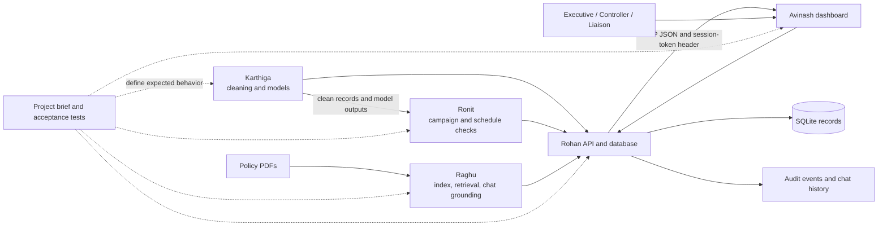

# Rohan's Wednesday–Friday Study and Presentation Guide

**Audience:** Rohan, the integration owner, and teammates who need to understand how the API, data, workflow, assistant, and dashboard connect.

**Purpose:** explain the files Rohan owns, the Monday–Friday story of the project, and the boundaries between each person's work.

**Study window:** Wednesday 11 November through Friday 13 November 2026 (IST).

**Use:** study the diagrams and file notes first; then use the talk track and questions for the Wednesday walkthrough.

> **Accuracy note:** This guide describes the repository snapshot inspected while it was written. It distinguishes the intended end-to-end design from code that currently exists. Recheck the listed files and their diffs after new Wednesday–Friday commits before presenting them as completed behavior.

## 1. What BreakCheck AI is for

BreakCheck AI supports an advertising-clearance desk. The intended user journey is:

1. A Clearance Executive opens an unassessed campaign and asks for checks.
2. The system reads the submitted copy, category, booked spots, schedule, and applicable policy evidence.
3. It calculates findings and prepares a recommendation. The recommendation is advisory; it does not itself clear the campaign.
4. A different Clearance Controller reviews the findings and records an allowed decision.
5. The service stores the decision and audit record. The dashboard displays the queue, assessment, documents, and history.
6. An Agency Liaison uses the chat to ask permitted policy questions or ask about a campaign belonging to an assigned agency.

The main design principle to explain is **separation of responsibility**: automated checks assemble evidence; an authorized human Controller makes the final decision.

## 2. The whole team in one picture



### What each person contributes

| Owner | Main files | What Rohan needs from that owner |
|---|---|---|
| Karthiga | `Project/data_pipeline/`, `Project/modeling/`, the two runner files, and data notes | Stable cleaned-data schemas, pipeline outputs, model interfaces, and a statement of which outputs are reproducible. Her nine Monday files are already recorded in `5 day war.md`. |
| Raghu | `Project/knowledge/`, `Project/chat/`, retrieval tools, policy PDFs, and indexing runner | A query function that returns relevant, source-attributed policy evidence; a clear refusal when evidence is insufficient. |
| Ronit | `Project/tools/` campaign/schedule tools and `Project/agentic/` | Deterministic spot findings, decision options, and workflow state that can be stored and shown to the Controller. |
| Rohan | API, authentication, access checks, database/repository, setup, API docs, and integration | A stable service contract and durable record of what happened. Rohan coordinates the interfaces; each domain owner fixes their own domain logic. |
| Avinash | `Project/dashboard/`, dashboard runner, UI tests, and manual UI guide | Screens that call the API and display its returned data without inventing workflow outcomes in the browser. |

## 3. How a request should travel through the system

```mermaid
sequenceDiagram
    actor Executive
    participant UI as Avinash dashboard
    participant API as Rohan FastAPI routes
    participant Auth as Rohan access + repository
    participant Data as Karthiga data/models
    participant Rules as Ronit campaign/workflow tools
    participant Knowledge as Raghu retrieval/chat
    participant DB as SQLAlchemy + SQLite
    actor Controller

    Executive->>UI: Sign in and open campaign
    UI->>API: POST /auth/sign-in
    API->>Auth: Verify password; issue session token
    Auth->>DB: Load account and save current token
    API-->>UI: Token, display name, role, permitted pages
    UI->>API: GET /queue with X-Session-Token
    API->>Auth: Resolve user and check intake permission
    API->>Data: Read cleaned facts/model result
    API->>Rules: Evaluate each booked spot and schedule
    API-->>UI: Queue row and campaign detail JSON
    Executive->>UI: Request assessment
    UI->>API: POST /assessments
    API->>Rules: Start assessment and pause at human decision gate
    API->>DB: Save assessment, workflow run, and audit facts
    API-->>UI: Assessment ID, findings, recommendation, open decisions
    Controller->>UI: Review a separate Controller's pending assessment
    UI->>API: POST /clearances/{id}/decision
    API->>Auth: Check Controller role and separation of duties
    API->>DB: Save decision, status, spot outcomes, audit event
    API-->>UI: Final result
    UI->>API: GET /audit and/or POST /chat/ask
    API->>Knowledge: Retrieve policy evidence when question is policy-related
    Knowledge-->>API: Answer, sources, refusal state
    API->>DB: Store chat turn and source names
```

The sequence is the **target integration story**. The current-code section below identifies places where the repository still takes shortcuts and therefore does not yet follow every arrow.

## 4. Rohan's job in plain language

Rohan owns the boundary between the specialist modules and the people using the application. His code should answer five questions:

1. **Who is asking?** Sign-in, password verification, and session lookup.
2. **What may that person do?** Role and area checks on the server for every protected endpoint.
3. **What information is saved?** Campaign, assessment, workflow run, decision, audit, and chat records.
4. **How does the UI call the system?** Stable routes, request validation, response shapes, and useful HTTP errors.
5. **How does another teammate start and verify it?** Setup scripts, dependency list, API examples, test instructions, and run documentation.

Rohan does not own the policy interpretation, model training, spot-rule definitions, or screen layout. He owns the service connections and makes sure the actual API response faithfully reflects those modules.

## 5. Rohan's file-by-file guide

The “diff story” below is a presentation aid: explain the responsibility and the reason for a change in that file. It is not a fabricated before/after patch. For exact changed lines, compare the owner's branch with the selected base commit using the command in [How to show a real diff](#how-to-show-a-real-diff).

### 5.1 API request and response contract

#### `Project/api/schemas.py`

**Role:** defines the shapes of JSON requests and responses that FastAPI validates.

- `SignInRequest`: username and password fields.
- `AssessmentRequest`: campaign reference plus a request text with a minimum length.
- `DecisionRequest`: decision plus a reason; `decision_reason` is also accepted by the route.
- `AssessmentResponse`: a typed shape for assessment identity, campaign, status, and optional result.

**Explain it like this:** “The schema is the form contract at the API door. It rejects malformed requests before business logic sees them.”

**Diff story to show:** what field was added/renamed, what validation prevents a bad request, and which dashboard/API caller must send the matching field. In the current code, avoid saying every response uses these models: several routes return ordinary dictionaries and lists.

#### `Project/api/routes.py`

**Role:** creates the FastAPI application and connects HTTP paths to authentication, permission checks, business modules, and persistence.

The current route families are:

| Route | Purpose | Main permission area |
|---|---|---|
| `POST /auth/sign-in` and `/auth/signin` | Verify a user and issue a session token | Public sign-in |
| `POST /auth/signout` | Invalidate the current token | Signed in |
| `GET /queue`, `GET /queue/{reference}` | Queue and campaign details | Intake |
| `POST /assessments` | Open one assessment for a campaign | Assessment |
| `GET /clearances`, `/clearances/{id}`, `/clearances/{id}/calls` | Read assessments and call records | Audit |
| `POST /clearances/{id}/decision` | Record a Controller's decision | Decision |
| `GET /audit`, `/audit/chat-turns` | Read audit records | Audit |
| `POST /chat/ask`, `GET /chat/turns` | Ask/inspect a user's chat history | Chat (audit endpoint requires audit area) |

Important route helpers:

- `current_user(...)` reads the `X-Session-Token` header, finds the matching database user, and returns HTTP 401 when the token is missing or invalid.
- `guard(user, area)` checks the role against `ROLE_AREA_ACCESS` and returns HTTP 403 on a denied area.
- `_data()` reads the open-campaign and booked-spot CSV inputs.
- `_chat_knowledge_base()` opens and caches Raghu's document index.
- `queue()` filters the queue after the intake permission check.
- `create_assessment()` validates the campaign, prevents a second assessment, and opens a pending record.
- `decide()` verifies the assessment is pending, prevents the starter from deciding it, validates the decision, stores the result, and writes an audit event.
- `ask()` calls the document assistant for policy questions, the campaign-status answerer for status questions, and stores the chat turn.

**Explain it like this:** “Routes are the traffic controller. They authenticate the caller, check permission, call the right owner module, and return a documented HTTP response.”

**Current-code caveat:** the queue and assessment routes still assemble several values directly in the route instead of relying on Ronit's full campaign tools and Karthiga's model predictions. See [What must not be overstated](#7-what-must-not-be-overstated-in-the-presentation).

### 5.2 Data storage and repository layer

#### `Project/persistence/database.py`

**Role:** creates the SQLAlchemy engine, database session factory, declarative model base, and schema setup/migration helpers.

- `DATABASE_URL` points to `Project/database/breakcheck.db`.
- `SessionLocal` creates sessions.
- `get_db()` yields a session and closes it after a request.
- `init_db()` creates tables and adds a few missing columns to older SQLite tables.
- `reset_db()` drops every mapped table and calls `init_db()` again.

**Important:** `reset_db()` is destructive. It must not run automatically on a real user's persistent database. In the current `routes.py`, module import calls `reset_db()` before seeding data. This is a known risk, not a feature to describe as safe production setup.

#### `Project/persistence/models.py`

**Role:** declares the database tables and their columns. The main records are:

| Model | What it records |
|---|---|
| `UserAccount` | Username, display name, role, assigned agencies, password hash, and current session token |
| `Campaign` / `Submission` | Campaign identity/status and submission data |
| `BookedSpot` / `CampaignNote` / `ProgrammeSchedule` | Input facts used by checks |
| `Assessment` | Starter, request, status, recommendation/result, Controller decision and timestamps |
| `AgentRun` | Workflow run ID, thread, state, and lifecycle status |
| `LLMCall` | Agent/model-call metadata and timing |
| `AuditEvent` | Actor, action, campaign reference, and details |
| `ChatTurn` | User question, answer, question category, sources, distance, and refusal flag |

**Explain it like this:** “A model class is the database's record shape. The route should not have to invent a new storage format for every page.”

#### `Project/persistence/repository.py`

**Role:** gives routes small persistence operations without making each route write SQLAlchemy queries from scratch.

- `authenticate()` loads a user, verifies the password hash, and saves a new session token.
- `get_by_token()` resolves the current request's token.
- `seed_users()` creates configured demo accounts if absent.
- `campaign()`, `list_campaigns()`, and `assessment()` load records.
- `create_assessment()` generates an `ASM-...` ID and saves the record.
- `import_csv()` imports open campaigns, submissions, booked spots, and notes if their unique IDs are not already present.
- `insert_chat_turn()` saves one chat turn.
- `fetch_assessment_records()` and `fetch_user_account()` support compatibility callers.

**Explain it like this:** “The repository is the storage adapter. This keeps endpoint code readable and makes it easier to test database behavior.”

### 5.3 Passwords, sessions, and permissions

#### `Project/access/password_security.py`

**Role:** hashes passwords with PBKDF2-HMAC-SHA256 and a random salt, verifies candidate passwords with a constant-time comparison, and creates random session tokens.

Representative actual code:

```python
digest = hashlib.pbkdf2_hmac(
    "sha256",
    str(password).encode(),
    salt,
    PASSWORD_HASH_ROUNDS,
)
return f"sha256${salt.hex()}${digest.hex()}"
```

The database stores the hash representation, not the submitted plain password. A successful sign-in creates a random token; subsequent requests send that token in the configured header. A sign-out clears the stored token.

#### `Project/access/permissions.py`

**Role:** maps roles to areas and offers `can_access_area`, `can_access_path`, and `require_area` helpers. `routes.py` uses `can_access_area` through its `guard` helper.

The role distinction in the current configuration is:

| Role | Permitted application areas |
|---|---|
| Clearance Controller | Intake, assessment, decision, audit, chat |
| Clearance Executive | Intake, assessment, audit, chat |
| Agency Liaison | Chat |

**Explain it like this:** “Hiding a button is not access control. The backend checks the role again on the request.”

### 5.4 Configuration and startup files

#### `Project/config/config.py`

**Role:** central place for project paths, data column names, labels, campaign categories, decision/status constants, roles, permissions, chat settings, API settings, and UI labels.

Examples of the groups Rohan should point to:

- `ROLE_*`, `AREA_*`, and `ROLE_AREA_ACCESS`: access matrix.
- `CAMPAIGN_STATUS_*` and `DECISION_*`: workflow vocabulary.
- `SESSION_TOKEN_HEADER`: authentication header name.
- `API_HOST`, `API_PORT`, `API_BASE_URL`: intended service settings.
- `OPEN_CAMPAIGNS_FILE`, `BOOKED_SPOTS_FILE`, `PROGRAMME_SCHEDULE_FILE`, `OPEN_CAMPAIGN_NOTES_FILE`: input locations shared with Ronit.

Keep spelling and capitalization consistent across API, dashboard, tests, and data. Do not add a second meaning for a status in a different module.

#### `Project/run_database_setup.py`

**Role:** standalone local setup command. It initializes the tables, creates seed accounts, imports the CSV rows, and closes its database session.

**Talk track:** “This is the explicit local preparation step. It is separate from the web request handlers and should be run before testing the service.”

#### `Project/run_api_service.py`

**Current state:** this file is zero bytes in the inspected checkout. It does not currently start Uvicorn, even though `Project/HOW_TO_RUN.md` describes it as an alternative entry point.

**What to do before presenting it as a working script:** implement a small Uvicorn entry point or update the run guide to use the existing `Project/run_project.ps1`/direct Uvicorn command. Do not say “run_api_service.py starts the API” until that is true.

#### `Project/.env.example`

**Role:** safe template for local environment configuration. It names the Gemini key/model variables and uses a placeholder value.

- Copy it to `.env` for local use.
- Replace the placeholder only on the developer's machine.
- `.env` must never be committed or placed in screenshots.
- Never paste a real API key into this guide, a chat, or a test fixture.

#### `Project/requirements.txt`

**Role:** declares Python packages needed by the app: data/model tools, SQLAlchemy, PDF/vector search packages, agent/model packages, FastAPI/Uvicorn, Streamlit, and test packages.

**Explain it like this:** “The dependency file lets another teammate install the same package set; it is a manifest, not application logic.”

### 5.5 API and handoff documentation

#### `Project/API_DOCUMENTATION.md`

Explains the API base URL, sign-in, queue/detail, assessment, Controller decision, audit, and chat routes with sample JSON and PowerShell calls. Keep the examples consistent with the actual schemas and routes. Avoid publishing real credentials or session tokens.

#### `Project/TEST_API_EXAMPLES.md`

Gives an ordered Swagger exercise: sign in, authorize with a session token, read queue/detail, create a pending assessment, then test the Controller path. It is a black-box exercise, so it should describe expected outcomes, not rely on hidden database details.

#### `Project/HOW_TO_RUN.md`

Explains install, `.env`, data/model/index preparation, tests, API, dashboard, and common failures. The current document should be updated to address the empty `run_api_service.py` and to state one correct API port/command.

#### `Project/docs/unit_testing.md` and `Project/docs/unit_testing.pdf`

The manual test guide helps a reviewer reproduce the system's behavior without reading implementation code. Keep the Markdown source and exported PDF in sync. It is Rohan's integration/documentation responsibility in the plan, but domain owners must supply correct expected facts for their own sections.

#### `README.md`

The repository entry point. It should tell a new teammate what BreakCheck is, where the project lives, and which setup guide to read first. Do not make the README contradict `HOW_TO_RUN.md`.

#### `PROJECT_UNDERSTANDING_AND_PLAN.md`

Contains the high-level project brief and functional contract. The current file includes statements that source modules are empty scaffolds; those statements are stale relative to the inspected implementation and need a factual update before using it as a presentation script.

#### `5 day war.md`

The work-allocation record: owners, exact files, push order, and non-staging rules. It is a planning document, not evidence that a test passed or a file reached `main`.

### 5.6 Optional repository integration files

#### `.github/workflows/build.yml`

This is the GitHub Actions/SonarCloud workflow, not the app's runtime. The working copy now reads `GITHUB_TOKEN` and `SONAR_TOKEN` from GitHub Actions secrets. The earlier committed version had inline credentials; do not quote/copy them. Configure the repository secrets and have the account owner revoke/rotate the exposed credentials. Replacing a value in a new commit does not erase it from Git history.

#### `sonar-project.properties`

Provides Sonar project identity/configuration. It should point to the intended project and should not contain access tokens. Keep it separate from API/runtime configuration.

## 6. Core API concepts, with examples

### 6.1 Sign-in and making a later request

The sign-in response includes the user's identity and a random session token. The UI/API client stores the token for the session and sends it in `X-Session-Token`. A human should not manually paste a token into code or source files.

PowerShell example using an authorized demo account supplied by the project owner:

```powershell
$baseUrl = "http://127.0.0.1:8000"
$loginBody = @{
    username = "<approved-demo-username>"
    password = "<approved-demo-password>"
} | ConvertTo-Json

$login = Invoke-RestMethod -Method Post `
    -Uri "$baseUrl/auth/sign-in" `
    -ContentType "application/json" `
    -Body $loginBody

$headers = @{ "X-Session-Token" = $login.session_token }
$queue = Invoke-RestMethod -Method Get `
    -Uri "$baseUrl/queue?product_category=All" `
    -Headers $headers
$queue | ConvertTo-Json -Depth 6
```

Do not copy the placeholder credentials into source or the presentation. The token is session data; treat it as private and sign out when finished.

### 6.2 Server-side access check

Simplified excerpt of the current design:

```python
def current_user(x_session_token=Security(session_token_header), db=Depends(get_db)):
    if not x_session_token:
        raise HTTPException(401, config.SIGN_IN_REQUIRED_MESSAGE)
    user = Repository(db).get_by_token(x_session_token)
    if not user:
        raise HTTPException(401, config.SIGN_IN_REQUIRED_MESSAGE)
    return user

def guard(user, area):
    if not can_access_area(user.role, area):
        raise HTTPException(403, ...)
```

Expected distinction:

- `401 Unauthorized`: sign-in is missing or invalid.
- `403 Forbidden`: identity is known, but that role is not allowed in the area.
- `404 Not Found`: requested campaign/assessment is absent.
- `409 Conflict`: action conflicts with saved state, such as a second assessment or a decision after closure.
- `422 Unprocessable Entity`: request fields/values fail validation.

### 6.3 Assessment and human decision gate

An assessment should be opened once per campaign. At the gate:

- status is `PENDING_DECISION`;
- a recommendation and evidence are visible;
- allowed choices depend on findings;
- the starter must not decide their own assessment;
- only a Clearance Controller can decide;
- a valid decision records who decided, why, when, resulting campaign status, spot outcomes, and an audit event.

For the talk, keep the phrase **“recommendation is not the decision”**. The human decision is the accountable action.

### 6.4 Chat and source attribution

`POST /chat/ask` first classifies/answers through Raghu's assistant. Campaign-status questions use the status-answer module. The API then saves the answer, source names, refusal flag, and user identity in a chat-turn row. The dashboard should display the sources and refusal status returned by the service.

## 7. What must not be overstated in the presentation

These are observations of the inspected source. The team should either fix them and re-check the new code before Wednesday, or describe them honestly as current limitations.

1. **Empty API runner:** `Project/run_api_service.py` is empty. `Project/run_project.ps1` uses direct Uvicorn startup instead.
2. **Port mismatch:** `Project/config/config.py` names port `8081`; `Project/run_project.ps1`, API docs, and test examples use `8000`. Choose one port and update all callers/docs together.
3. **Database reset on API import:** `Project/api/routes.py` attempts `reset_db()` during import. `reset_db()` drops all mapped tables. This can erase saved assessments every time the service process starts. The same broad `try/except Exception: pass` can hide a failed initialization. A persistent-service demo must use explicit setup and a safe startup path.
4. **Queue shortcut:** `_queue()` currently reads the input CSVs directly and computes a synthetic breach count (including a campaign-reference special case and a percentage estimate). It does not call the full schedule/rule engine or Karthiga's trained models. Do not call that current output a proven model prediction or full category-code result.
5. **Detail shortcut:** current detail generation assigns a simplified `WINDOW` code and uses fixed placeholder issue/category facts in parts of its response. It should consume Ronit's per-spot results and the real campaign/model outputs.
6. **Assessment placeholders:** the route inserts placeholder call rows/text and populates fixed sample fields such as an issue category, assessment prose, and recommendation. A call to the workflow graph also occurs, but the returned API payload is not a proof that the graph generated those placeholder fields.
7. **Decision document placeholders:** the decision route records the selected status and audit data, but its generated notice/certificate text and some call records are placeholder strings. Do not claim that it generated final compliant agency documents until the output is produced by the document workflow and reviewed.
8. **CI credential exposure:** the working copy now references Actions secrets, but the older Git history contains credentials. Configure the secrets and rotate/revoke the exposed credentials before treating the repository as safe to share.
9. **Seeded local accounts:** `config.py` includes development/demo account definitions. These are not production identity management. Do not show account passwords in public documentation; use only SME-approved local demo access.
10. **Docs drift:** `PROJECT_UNDERSTANDING_AND_PLAN.md` claims much of the implementation is empty, `HOW_TO_RUN.md` mentions the empty runner, and the API port references are inconsistent. Rohan should align these docs to code that has actually been fixed.

These caveats are not reasons to hide the architecture. They help the team separate **what a module is meant to do** from **what the current integration really does**.

## 8. Wednesday-to-Friday study and presentation plan

Use this as a study sequence, not a claim that all future work is already merged.

### Wednesday — explain the full Monday–Friday system

1. **Monday: data foundation (Karthiga).** Show the raw data families, cleaning pipeline, validation/profile outputs, and why model inputs need a consistent schema.
2. **Tuesday: owners and interfaces.** Show the one-page ownership table and identify the shared boundaries: data schemas, tool inputs/outputs, API JSON, and UI pages.
3. **Wednesday: service and workflow (Rohan + Ronit).** Sign in, read a queue, open details, create a pending assessment, explain the Controller gate, and point to the record/audit trail. Clearly flag any current placeholder behavior.
4. **Thursday: knowledge and review (Raghu + Avinash).** Demonstrate how a policy question retrieves a source, then show how the dashboard presents queue/detail/chat/decision/audit data from the service.
5. **Friday: integrated acceptance and SME handoff.** Walk through the black-box test checklist and close by identifying the release commit, test output, known limitations, and remaining owner.

### Thursday — explain one cross-team path in depth

Trace a single request all the way across: CSV/document source → owner module → service route → database record → dashboard screen → test assertion. Ask each owner to explain their input and output, then let the next owner explain how they consume it.

### Friday — explain evidence and ownership

For each demonstrated claim, show its evidence: a code path, an API response, a saved row, a source citation, a screenshot, or a passing test result. A commit on `main` proves a change was pushed; it does not prove the feature works.

## 9. Rohan's suggested Wednesday talk track (8–10 minutes)

1. **Problem (45 sec):** “The desk needs consistent checks, traceable evidence, and a human Controller decision.”
2. **Users and boundaries (60 sec):** identify Executive, Controller, Liaison and why their server permissions differ.
3. **Request path (2 min):** show the Mermaid sequence and explain token → route → permission → module → repository → JSON response.
4. **Files (2 min):** point to schemas, routes, database/repository/models, access/config, then run/docs.
5. **Cross-team integration (1 min):** point to the Karthiga/Ronit/Raghu/Avinash boundary table.
6. **Live/API walk (2 min):** sign in, fetch queue, open detail, then show a pending assessment and a separate Controller decision only if the local state is safe and the route is working.
7. **Truthful status (1 min):** distinguish verified behavior from the issues in section 7; name owner and file for each unresolved item.

Do not create or decide a campaign in a shared demo database unless the team has chosen a fresh disposable campaign. Decisions change persisted state.

## 10. File-by-file “diff explanation” worksheet

Before presenting a changed file, fill these four lines from the actual Git diff:

```text
File:
What was there before:
What changed in this branch:
Why the change matters / which next module consumes it:
Evidence (test, command, response, or screenshot):
```

Use the actual branch diff; do not infer a change from a filename:

```powershell
git diff -- Project/api/routes.py
git diff -- Project/api/schemas.py Project/persistence
git diff -- Project/access Project/config/config.py
git diff -- Project/API_DOCUMENTATION.md Project/HOW_TO_RUN.md
```

For the full branch against its base:

```powershell
git diff origin/main...HEAD -- Project/api Project/persistence Project/access Project/config
```

If a file was already on `main` and has no diff, say it is an existing integration component. Do not describe it as Rohan's new contribution.

## 11. Study commands and expected evidence

Run these from the `Project` folder when the owner says the current branch is ready. Do not run a destructive database reset on a database that contains needed work.

### Start API using the existing project runner

```powershell
.\run_project.ps1 -SkipKnowledgeIndex -SkipModelTraining
```

The runner currently binds to port `8000`. The mismatch with configured `8081` and the destructive import-time reset must be addressed before treating this as a safe persistent setup.

### Open API docs

```text
http://127.0.0.1:8000/docs
```

### Acceptance suite (documented command)

```powershell
$env:BREAKCHECK_CHAT_OFFLINE = "1"
python -m pytest ..\pytest\tests.py tests -q
$pytestExitCode = $LASTEXITCODE
Remove-Item Env:BREAKCHECK_CHAT_OFFLINE
exit $pytestExitCode
```

Passing means the process exits with code zero and no failure. Keep the output with the commit/SME notes. This guide was written as documentation; its commands are instructions and are not a claim that the suite was run during documentation writing.

### Evidence checklist for Rohan

- [ ] API starts from the documented command and documented port.
- [ ] Sign-in returns the expected role and a session token; a missing token gets 401.
- [ ] A role with no intake access gets 403 on queue endpoints.
- [ ] A campaign detail response agrees with the source/tool spot results.
- [ ] A campaign can only be assessed once and remains pending until a Controller decision.
- [ ] The assessment starter is denied from deciding their own work.
- [ ] The chosen decision, reason, actor, time, status, spot outcome, and audit row agree.
- [ ] Chat status is agency-scoped; policy answers carry relevant source names or an explicit refusal.
- [ ] Existing user data survives a normal service restart.
- [ ] Documentation examples use the same port, payload fields, and response facts as the running API.
- [ ] CI uses configured Actions secrets, and exposed historical credentials have been rotated.

## 12. Questions teammates may ask Rohan

**Why use FastAPI?** It exposes typed HTTP routes and interactive OpenAPI documentation so the UI and test client can use the same contract.

**Why separate the repository from routes?** Routes handle HTTP and access. The repository handles storage operations. That makes each easier to change and test.

**Why is the Controller a different person from the assessment starter?** It is a separation-of-duties rule: the reviewer cannot approve their own assessment.

**Why does a Liaison have less access?** The Liaison's view is limited to chat/status information for their agencies; operational decisions belong to internal staff.

**Does the model make the final decision?** No. It should supply findings and a recommendation. A Controller records the accountable decision.

**Can you show that the current API already uses all models and rules?** Not from the inspected route code. Some queue and assessment values are still constructed with shortcuts/placeholders; show the relevant actual test and implementation after the domain integrations land.

**Why not just start `run_api_service.py`?** It is empty in the inspected checkout. Use the existing runner/direct command until it is implemented and verified.

**What proves the feature is finished?** A change on `main`, a passing relevant test, a live request/response, and a saved record where applicable. A commit alone proves only that the file was pushed.

## 13. Short glossary

| Term | Meaning |
|---|---|
| API | The HTTP interface used by the dashboard and test client |
| Route/endpoint | One API path and method, such as `GET /queue` |
| Schema | A validation rule and shape for request/response data |
| Session token | Random proof that a user signed in; sent in the configured header |
| Role/area | The user's job category and the API capability being checked |
| Repository | Database operations kept behind a small interface |
| Assessment | Saved automated review and recommendation awaiting or containing a human decision |
| Audit event | A record of who performed an important action and when |
| Retrieval | Finding relevant passages in the approved policy document collection |
| Placeholder | Demonstration/sample content that is not generated from the real module result |
| Acceptance contract | The supplied tests that express required behavior; do not edit them to make failures disappear |

## 14. One-minute summary Rohan can memorize

“My part is the service boundary. FastAPI receives requests, validates them, identifies the signed-in user, checks that person's role, calls the domain modules, and saves the result through the repository. Karthiga supplies clean data and model interfaces, Ronit supplies campaign and schedule decisions, Raghu supplies source-grounded policy answers, and Avinash presents API responses in the dashboard. The Controller remains the final decision-maker. I will show what works from the current branch, identify any placeholders or integration gaps clearly, and use tests plus live responses as evidence.”
