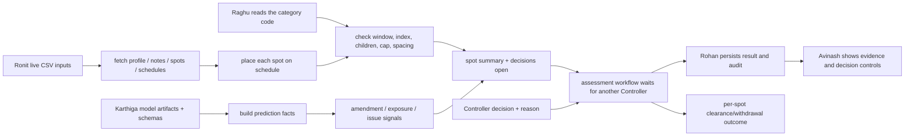

# Ronit's Wednesday–Friday Study and Presentation Guide

**Audience:** Ronit and teammates who need to understand campaign facts, policy checks, and the Controller decision gate.

**Purpose:** explain every Ronit-owned file in `5 day war.md`, show how data/model/policy inputs become deterministic spot findings, and connect the workflow to Rohan's API and Avinash's dashboard.

**Study window:** Wednesday 11 November through Friday 13 November 2026 (IST).

**Use with:** the relevant code passages, `Project/docs/unit_testing.md`, and the project's source data.

> This guide describes the inspected source snapshot. Compare new work to its real Git diff before presenting it as finished.

## 1. Ronit's responsibility

Ronit's domain translates campaign inputs and written rules into per-spot checks, campaign totals, valid decision options, and post-decision spot outcomes. Ronit owns the checks and workflow; Rohan owns how an authenticated request is saved/returned, and Avinash owns how the API result is displayed.

The rules should be explainable one step at a time:

1. identify the campaign, notes, spots, and relevant schedules;
2. place every booked spot on the correct programme/broadcast day;
3. load that campaign category's rules from its own source code;
4. apply every rule to every spot and explain breach codes;
5. aggregate breaches/compliant spots and determine which decisions are open;
6. pause at the Controller gate;
7. after a valid human decision, list the spots cleared/withdrawn.



## 2. Four campaign input files

These are live queue/tool inputs under `Project/data/input/`; they are different from Karthiga's five historical training/pipeline CSVs.

| Exact path | Role in checks |
|---|---|
| `Project/data/input/open_campaigns.csv` | One profile/submission row for each campaign, including reference, category, advertiser/agency and other model inputs |
| `Project/data/input/open_campaign_notes.csv` | Ordered notes used to classify issue signals and explain the case |
| `Project/data/input/booked_spots.csv` | Individual spot/channel/day/break/clock records to assess |
| `Project/data/input/programme_schedule.csv` | Programme start/end and flags/audience facts needed to place each spot and apply rules |

Treat each CSV as source input. If it changes, show the row/file change and how the expected check changes. Do not commit derived assessments or generated outputs as replacement input data.

## 3. Monday–Friday team story

- **Monday:** Karthiga's cleaners establish trustworthy values and units. Ronit consumes the live campaign CSVs; do not confuse training history with the queue.
- **Tuesday:** agree exact schemas: campaign reference, note sequence, spot reference, category, channel, scheduler type, time, and schedule fields.
- **Wednesday:** explain campaign retrieval → placement → rule checks → aggregation → decision options.
- **Thursday:** connect the model signals from Karthiga and policy facts from Raghu; connect the record and decision API from Rohan; follow it through Avinash's UI.
- **Friday:** demonstrate edge cases and report which checks are evidenced by tests and which are not yet integrated.

## 4. File-by-file guide

### 4.1 `Project/tools/campaign_data_tools.py`

This is the input adapter for the campaign dataframes:

- `_records(frame, reference)` rejects a reference outside the queue.
- `fetch_campaign_notes()` rejects duplicate/invalid note sequence, rejects blank note text, sorts notes by sequence, and returns ordered dictionaries.
- `fetch_campaign_profile()` requires exactly one profile row.
- `_number()` parses seconds, minute:second, or hour:minute:second values.
- `_clock_length()` validates the clock-number pattern and standard length.
- `fetch_campaign_spots()` returns the campaign's booked spots with a validated clock-number-derived length.
- `fetch_campaign_schedules()` returns matching-channel schedule rows while accounting for configured channel aliases.

**Explain it like this:** “The tools verify the campaign and reshape raw rows into predictable records before a model or rule check runs.”

### 4.2 `Project/tools/prediction_tools.py`

Connects Karthiga's saved models to live queue data:

- `build_amendment_facts(model, schema, campaigns)` creates the ordered feature frame, gets class-1 probabilities, rounds them, and maps score to HIGH/MEDIUM/LOW configured bands.
- `build_exposure_forecasts(model, schema, airings)` adds slot-minute features, predicts audience values, rounds them, and returns airing IDs with estimates.
- `build_issue_facts(model, notes)` filters notes shorter than the minimum, predicts issue labels, weights votes by note source, calculates weighted agreement, and returns each note's reading.

**Important:** these are learned signals. They do not prove a breach or decide clearance. A low amendment probability cannot override a deterministic code violation.

### 4.3 `Project/tools/schedule_tools.py`

This is the core deterministic per-spot rule engine.

#### Placement: `place_spot(spot, schedules)`

- normalizes channel, scheduling system, and weekday;
- parses the break time;
- converts calendar clock times before the broadcast day start into the next-day minute count and previous broadcast day;
- finds the programme containing the spot, or both programmes when the break lies exactly on a boundary;
- returns the canonical broadcast day, break time, programme(s), and placement marker.

#### Checks: `check_campaign_spots(placements, code)`

For every spot it checks:

1. restricted hours and the category's live-sport exception (the exception applies only to a centre break with both required margins);
2. audience index threshold in the programme(s);
3. whether the children's-programme rule applies to an in-programme or adjacent break;
4. per-channel/per-broadcast-day cap;
5. minimum spacing from the previous spot.

Each result records the spot reference, breach codes, placement data, and compliant/breaching label. The five configured breach types are window, index, children, frequency, and separation.

#### Summary/outcome: `summarise_spot_checks()` and `compute_clearance_outcome()`

The summary counts booked/compliant/breaching spots, counts each breach rule, finds first transmission, and lists open decisions. With no breaches it can open CLEAR or REJECT. With both compliant and breaching spots it can open CLEAR WITH RESTRICTIONS or REJECT. If every spot breaches, it opens REJECT only. The outcome function rejects a decision that is not open and computes the exact cleared/withdrawn spot references.

Simplified excerpt based on the actual check:

```python
if restricted and live_sport_exception_applies:
    restricted = False
if restricted:
    breaches.append(BREACH_WINDOW)

if any(programme_audience >= code["index_threshold"] for programme in programmes):
    breaches.append(BREACH_INDEX)
```

The source applies the other three rules after these checks; show the full function when explaining all five.

### 4.4 Agent workflow files

#### `Project/agentic/state.py`

Defines the typed workflow state fields: campaign/assessment/run IDs, user, submissions, spots, notes, analyses, decision, result, status, and error. A shared state makes it clear what one node can pass to the next.

#### `Project/agentic/nodes.py`

Contains a planner node, an agent-analysis node factory, and a writer node. Nodes add their named results to `state["analyses"]`; the writer prepares a result and marks the workflow as awaiting a human decision.

#### `Project/agentic/agents.py`

Contains two relevant layers:

- `call_language_model()` loads local `.env`, sends Gemini generation when a model/key are configured, rejects incomplete/empty responses, and returns response/call timing metadata. Its REST fallback keeps the key in an HTTP header.
- `call_model()` used by the current workflow nodes has a deterministic fallback and optionally records an `LLMCall` through the provided repository.
- `parse_labelled_response()` handles decorated labels and validates required sections.

Never paste an API key in code or teaching materials. Do not claim an LLM ran unless the returned generation mode/call record shows it.

#### `Project/agentic/graph.py`

Names the ten workflow stages and represents the pause/decision routes. `build_graph()` calls planner, copy-risk, issue, schedule, and writer nodes in sequence. `build_workflow()` currently returns a local `_Compiled` helper that stores a JSON checkpoint; it is not a fully constructed LangGraph graph in the inspected source, even though LangGraph packages are listed as dependencies.

The intended logical path is:

```text
load context → plan → copy risk → identify issues → check spot schedule
→ compose assessment → await Controller → draft appropriate documents
→ record outcome
```

The `request_controller_decision` node is the human gate. A decision routes to the corresponding certificate/restriction/record outcome path, and a finished run should resume without repeating earlier model calls.

### 4.5 `Project/tests/test_campaign_workflow.py` (new, only if created)

This path does not exist in the inspected tree. If Ronit creates it, use it for focused checks: broadcast-day rollover, programme boundaries, every breach rule, decision-open logic, valid/invalid outcome, and per-spot cleared/withdrawn lists. Do not claim a test exists until it is added and run.

## 5. How to teach one spot check

Pick a campaign category, one spot reference, and its schedule rows. Explain:

1. **Input:** campaign reference/category, spot clock, channel, schedule type, break time.
2. **Placement:** broadcast day plus programme or adjacent programmes.
3. **Source:** Raghu's category-specific code values and source sentence.
4. **Check:** compare the placed spot against all five rule families.
5. **Output:** breach-code list; empty list means compliant under the implemented checks.
6. **Aggregate:** count spots and determine decisions open.
7. **Human step:** Controller chooses from the open options; then map decision to specific spots.

Do not skip step 3. A number taken from the wrong product category is a wrong result even if arithmetic is correct.

## 6. Where the other owners join

| Owner | Boundary into Ronit's work | Boundary out of Ronit's work |
|---|---|---|
| Karthiga | cleaned campaign/note/audience features, model objects, schemas, prediction methods | predictions and issue facts returned by `prediction_tools.py` |
| Raghu | `read_category_code(collection, category)` and document-scoped issue/standing-guidance passages | category rule facts consumed by `check_campaign_spots()` |
| Rohan | authenticated assessment request and persisted campaign/assessment records | API JSON with evidence, open decisions, outcomes, and audit facts |
| Avinash | consumes only API data; does not reimplement schedule logic | page displays spot evidence and Controller decision choices |

### Intended versus inspected integration

The domain tools implement the interfaces above, but `Project/api/routes.py` currently constructs simplified queue/details and a placeholder assessment payload directly. It does not yet demonstrate that all of `prediction_tools.py`, `read_category_code()`, and `check_campaign_spots()` are wired into the live API result. Point out the actual call path and test before claiming complete end-to-end integration.

## 7. Current limitations to explain honestly

1. The API queue route uses synthetic breach estimates; its detail route assigns a simplified `WINDOW` finding. This is not the output of the full schedule engine in the inspected code.
2. Assessment result fields/call rows are partially fixed placeholders in the API route. A workflow graph invocation alone does not make those fields data-derived.
3. The workflow uses a local compiled/checkpoint helper in the inspected version, not a fully wired LangGraph implementation.
4. `call_model()` can use a deterministic fallback; show the stored model name/fallback flag before describing outputs as live Gemini responses.
5. Agency documents in the API route have placeholder text. Do not describe those strings as final generated certificate/notice documents.
6. Session/database startup behavior is owned by Rohan and currently resets SQLite during API import; coordinate before demos that must preserve records.
7. `Project/tests/test_campaign_workflow.py` is not present yet; the acceptance tests are under `pytest/tests.py`.

## 8. Wednesday–Friday explanation plan

### Wednesday: explain tools and human gate (8 minutes)

1. Begin with one campaign and the four `data/input` files.
2. Trace data fetch/validation from `campaign_data_tools.py`.
3. Show the campaign's own category mapping and Raghu's code facts.
4. Place one spot on the schedule; draw its broadcast day and neighboring programme.
5. Walk all five checks and list the resulting breach codes.
6. Summarize the campaign and read the allowed decisions.
7. Pause for a different Controller; explain `compute_clearance_outcome()` after the choice.
8. Hand to Rohan for persistence/API and Avinash for display.

### Thursday: integration rehearsal

Follow one fresh campaign through actual tool call → API response → UI row → decision write → persisted outcome. If the route bypasses a tool, identify the file and owner before showing it.

### Friday: edge cases and evidence

Show one ordinary time, one after-midnight rollover, one programme-boundary break, one exception case, one repeated/cap case, and one insufficient-evidence case. Keep test output and inputs next to the demo record.

## 9. Real-diff worksheet

```text
File:
What changed in the real branch diff:
Which input/schema does it use:
What result does it produce:
Who consumes that result next:
Which test or live example proves it:
```

```powershell
git diff -- Project/tools/campaign_data_tools.py Project/tools/prediction_tools.py
git diff -- Project/tools/schedule_tools.py Project/agentic
git diff origin/main...HEAD -- Project/tools Project/agentic
```

## 10. Evidence commands

Acceptance tests (from the `Project` directory):

```powershell
$env:BREAKCHECK_CHAT_OFFLINE = "1"
python -m pytest ..\pytest\tests.py tests -q
$pytestExitCode = $LASTEXITCODE
Remove-Item Env:BREAKCHECK_CHAT_OFFLINE
exit $pytestExitCode
```

Use a campaign that has not been assessed in the local demo database. Record the input reference, the placed broadcast day/programmes, code document, all five rule counts, allowed decisions, actor for the final decision, and resulting spot IDs. A passing unit test does not replace the live API/UI flow.

## 11. Questions Ronit may be asked

**Why are checks per spot rather than per campaign?** Different spots can be on different days/programmes and only some may breach; the Controller needs exact spot-level evidence.

**What happens at a programme boundary?** The spot is adjacent to both programmes, so the configured children's rule can apply to the pair; the exact logic depends on the category's code.

**What does the live-sport exception change?** Only the restricted-window result, and only if that category's source code has an exception and the spot is a qualifying centre break with both time margins.

**Can the Executive's recommendation clear a campaign?** No. The route must stop at `PENDING_DECISION` and a separate authorized Controller records the decision.

**Does model output determine a code breach?** No. It provides predictive context. Rule compliance is tested against source facts and category-specific rule values.

**What if the user chooses a closed decision?** `compute_clearance_outcome()` should reject it; the API should also protect the saved status. Test both layers where applicable.

## 12. One-minute summary

“My tools turn live CSV rows into validated campaign facts, place each spot on the correct programme/broadcast day, and check the applicable category code one spot at a time. They then summarize compliant and breaching spots, decide which Controller choices are open, and calculate exact spot outcomes after a human decision. Karthiga provides predictive signals, Raghu provides the category's source rules, Rohan saves and serves the result, and Avinash shows it. A risk score is not a policy breach, and an automated recommendation is not the final decision.”
