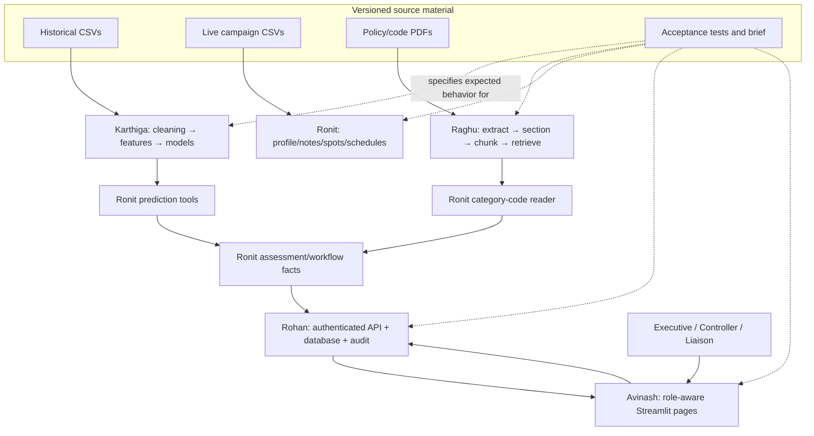

# BreakCheck AI Team Study Guide: Wednesday–Friday

**Audience:** Rohan, Karthiga, Raghu, Ronit, and Avinash.

**Purpose:** give the whole team one shared story to study and explain on Wednesday, then use Thursday and Friday to verify the interfaces and demonstrate evidence.

**Study window:** Wednesday 11 November through Friday 13 November 2026 (IST).

**Structure:** this shared guide explains the product, team handoffs, and presentation. Each person also has a separate file-by-file guide linked below.

> The team guides were written from the current repository snapshot. Before presenting new work, compare the exact branch diff, run the relevant checks, and update any finding that the new code has fixed.

## Start here: individual guides

- [Rohan — API, persistence, access, integration, and presentation](ROHAN_WEDNESDAY_TO_FRIDAY_GUIDE.md)
- [Karthiga — data cleaning, models, and model handoff](KARTHIGA_WEDNESDAY_TO_FRIDAY_GUIDE.md)
- [Raghu — policy documents, retrieval, and assistant](RAGHU_WEDNESDAY_TO_FRIDAY_GUIDE.md)
- [Ronit — campaign facts, schedule checks, and workflow](RONIT_WEDNESDAY_TO_FRIDAY_GUIDE.md)
- [Avinash — dashboard, navigation, and manual UI flow](AVINASH_WEDNESDAY_TO_FRIDAY_GUIDE.md)

Each role guide covers its owner's exact paths in `5 day war.md`, gives a file-by-file explanation, contains code examples and diagrams, calls out limitations found in the inspected version, and has a real-diff worksheet. Use this shared file first to learn how the parts meet.

## 1. The application problem in plain language

BreakCheck AI helps an advertising-clearance team examine a campaign. It brings together historical data, learned risk signals, policy evidence, deterministic spot checks, a human Controller decision, and an audit trail. The UI helps the people involved understand where they are in that process.

| User | What the role does |
|---|---|
| Clearance Executive | Opens campaigns, requests an assessment, and follows it |
| Clearance Controller | Reviews pending evidence and records the final decision; a Controller cannot decide their own assessment |
| Agency Liaison | Asks supported policy/status questions within their assigned agency access |

The core rule for every presentation is:

> **Model prediction, policy evidence, deterministic rule check, and human decision are four different things. Do not describe one as another.**

## 2. How each person's work joins up



### The handoff in ordinary language

1. **Karthiga** turns five historical CSVs into consistent cleaned files and trains three prediction models. She documents feature names and units.
2. **Raghu** turns sixteen policy/code PDFs into searchable source evidence and answers questions from that evidence. His source names let a user check the answer.
3. **Ronit** reads one campaign's profile, notes, spots, and schedule; combines predictions and rule facts; checks spots; and calculates which outcomes are open.
4. **Rohan** authenticates the caller, checks role permissions, exposes the API contracts, saves the assessment/decision/audit/chat facts, and returns JSON.
5. **Avinash** calls that API, shows each user's next step, and presents the returned facts, choices, sources, and errors.

An owner hands off a **stable input and output**, not their whole job. For example, the dashboard should not copy the schedule engine; it should show the schedule result returned by the service.

## 3. One complete user journey to teach

```mermaid
sequenceDiagram
    actor E as Clearance Executive
    participant V as Avinash dashboard
    participant A as Rohan API
    participant K as Karthiga data/model outputs
    participant R as Ronit campaign checks
    participant G as Raghu policy evidence
    participant DB as Rohan repository/database
    actor C as Different Clearance Controller

    E->>V: Sign in and open the queue
    V->>A: POST sign-in; then GET queue with session header
    A->>DB: Verify user and resolve session
    A-->>V: Role, pages, queue JSON
    E->>V: Select a campaign and request assessment
    V->>A: POST /assessments
    A->>K: Get amendment/exposure/issue signals
    A->>R: Get spot placements, checks, open outcomes
    R->>G: Read this campaign category's code/evidence
    A->>DB: Save pending assessment, run and audit facts
    A-->>V: Pending assessment + recommendation + evidence
    C->>V: Review the pending assessment
    V->>A: POST decision + reason
    A->>DB: Enforce role/separation; save outcome and audit event
    A-->>V: Recorded decision and spot outcomes
    V->>A: Ask policy/status question
    A->>G: Retrieve grounded answer or refusal
    A->>DB: Save chat turn and source names
    A-->>V: Answer, sources, refusal/fallback state
```

This is the target story to explain. For every live step, show the actual endpoint, tool invocation, or saved record that proves the arrow exists in the current branch.

## 4. What to explain Wednesday: Monday through Friday

Wednesday is the shared architecture walkthrough. Explain the full planned week as a connected story, while being explicit about what is already done and what is still a future or blocked task.

### Monday — data foundation

Karthiga reported the cleaning modules, data runner, and `Project/tests.py` as pushed. Explain the five training/pipeline input datasets, why blanks/units/clocks need normalization, how cleaned outputs and a quality report are produced, and how later models use train/eval splits.

**Do not say:** that `Project/tests.py` contains the acceptance suite; it is empty in the inspected snapshot. The full contract is `pytest/tests.py`.

### Tuesday — ownership and contracts

Show the exact owner/file lists in `5 day war.md`. Explain that teams agree on shared field names, campaign references, units, status/decision labels, source document names, route paths, and test commands before merging.

### Wednesday — explain how the pieces fit

Each person teaches their module from its guide, then hands a real output to the next owner. Follow the complete user journey above. Do not present a design intention as completed code without a diff/test/response.

### Thursday — integration and end-to-end evidence

Pick one fresh campaign reference. Follow actual CSV rows through placement and rule checks; show source policy text, API response, dashboard display, pending gate, second Controller decision, database status, and audit entry. Record which step failed if the route still bypasses an owner module.

### Friday — review, demo, and handoff

Demonstrate one successful path and meaningful refusals/permission errors. Present the commit ID, test output, manual test results, known limitations, and next owner for each unresolved item. A merge alone does not prove behavior.

## 5. The five technical boundaries everyone should know

### A. Data boundary

- Karthiga's five historical files are under `Project/data/`.
- Ronit's live queue files are under `Project/data/input/`.
- Cleaned files, reports, model binaries, checkpoint databases, and indexes are generated outputs and should normally be rebuilt locally, not copied into Git.

### B. Prediction versus policy boundary

- A model score estimates a historical pattern.
- A policy PDF supplies written requirements.
- A deterministic checker compares a booked spot to the applicable requirement.
- A Controller chooses the final outcome.

### C. API boundary

The dashboard calls HTTP endpoints and gets JSON. The API must validate request shapes, identify the signed-in user, enforce role permissions, call the domain tools, persist records, and return facts that agree with those tools.

### D. Human-decision boundary

An assessment stays `PENDING_DECISION` until an authorized, different Controller decides. The app must not let the starter self-approve; the selected option must be among the open decisions; reason and result should be recorded.

### E. Source and memory boundary

Policy answers should carry source document names. Campaign status comes from a record lookup and must respect Liaison agency access. Conversation memory should be scoped to the signed-in user and should not repeat private campaign details into a policy-generation prompt.

## 6. Shared API example for study

This snippet is a shape example; use an SME-approved local account. Do not place actual credentials or a returned token in slides, source code, or screenshots.

```powershell
$baseUrl = "http://127.0.0.1:8000"
$login = Invoke-RestMethod -Method Post `
  -Uri "$baseUrl/auth/sign-in" `
  -ContentType "application/json" `
  -Body (@{ username = "<demo-user>"; password = "<demo-password>" } | ConvertTo-Json)

$headers = @{ "X-Session-Token" = $login.session_token }
$queue = Invoke-RestMethod -Uri "$baseUrl/queue?product_category=All" -Headers $headers
$queue | Select-Object -First 1 | ConvertTo-Json -Depth 6
```

The UI performs this token handoff automatically; ordinary users do not copy tokens into application fields.

## 7. Important current-code findings to reconcile before the walkthrough

These were visible in the inspected snapshot and should be checked against the newer branch. Do not conceal them; either fix them before the demo or mark them as limitations.

1. **Two empty runners:** `Project/run_api_service.py` and `Project/run_knowledge_indexing.py` are zero bytes. The project API runner is actually `Project/run_project.ps1`; knowledge indexing currently happens lazily from `open_vector_index()`.
2. **Port mismatch:** config names API port 8081 while the project runner and docs use 8000. Streamlit uses port 8080. Agree on a single documented API address.
3. **Destructive API import:** `Project/api/routes.py` calls `reset_db()` during module import; `reset_db()` drops every mapped table. This can erase local demo records on service restart. The broad exception handler may hide setup errors.
4. **Live API shortcuts:** queue/detail routes currently synthesize breach counts and several risk fields rather than calling all of Karthiga's model tools and Ronit's full rules engine. Assessment/call/document strings also include placeholders. Show a tool call and test before claiming full integration.
5. **Index terminology:** `Project/knowledge/vector_index.py` currently has a lexical BM25-style JSON ranker; it is not using embedding vectors in the inspected path.
6. **Runner/test mismatches:** `Project/tests.py` is empty; acceptance coverage is in `pytest/tests.py`. Update the guide before saying the empty file proves coverage.
7. **CI credentials:** the working copy of `.github/workflows/build.yml` now reads credentials from GitHub Actions secrets. An earlier committed version contained inline credentials. Configure the secrets and have the account owner revoke/rotate the exposed values; deleting them in a later commit does not erase history. Never copy them into a guide.
8. **Demo credentials in UI/config:** local demo account values are embedded in source/UI. Keep them out of public demos and replace with SME-approved local credentials before external sharing.
9. **Documentation drift:** `PROJECT_UNDERSTANDING_AND_PLAN.md`, `HOW_TO_RUN.md`, API docs, and configuration disagree about implementation and ports. Rohan should align docs to the verified code.

## 8. Presentation handoffs: what each person says about the next person

| Presenter | Explain their part, then hand off by saying… |
|---|---|
| Karthiga | “These are the cleaned field names, units, features, and model outputs. Ronit consumes the predictions, then Rohan should return the actual values.” |
| Raghu | “These are the source passages and category rule facts. Ronit's checks use the relevant category's values; the API/chat returns source names for the reviewer.” |
| Ronit | “These are the campaign facts, placements, rule results, and open decisions. Rohan persists the pending record, and Avinash displays it to the right role.” |
| Rohan | “These routes authenticate and save the response. The values must come from the owner module that produced them; Avinash is the client.” |
| Avinash | “These pages guide the user and show the API result. The API enforces permissions; the domain owners are responsible for the facts displayed here.” |

Every person should be able to answer three simple questions about another person's work: **What input does it read? What output does it return? Which next module consumes it?**

## 9. Shared Wednesday talk plan (30–40 minutes)

1. **Rohan, 4 min:** purpose, roles, overall diagram, API boundary.
2. **Karthiga, 5–6 min:** raw input → cleaning → features → three models; show output units.
3. **Raghu, 5–6 min:** PDF → passage → retrieval → answer/refusal/source; distinguish BM25 from generation.
4. **Ronit, 7–8 min:** campaign data → broadcast placement → five rule families → open decisions → human outcome.
5. **Avinash, 5–6 min:** sign-in → role Home → queue/detail → assessment/decision/audit/chat.
6. **Rohan, 5 min:** trace the route/database/audit contract across the earlier screens.
7. **All, 5 min:** evidence and limitations. Each unresolved issue gets an exact file and owner.

If the team only has time for one end-to-end demo, keep it simple: sign in → queue → detail → pending assessment → different Controller's decision → audit. Then do a separate chat question with a source citation and an out-of-scope refusal.

## 10. How to make each person's real diff file

The role guides explain files; they do not invent prior code or pretend that existing files changed. For every actual branch, export or capture a real diff. From the repository root, for each owner:

```powershell
git fetch origin
git diff --stat origin/main...<owner-branch>
git diff --check origin/main...<owner-branch>
git diff --no-ext-diff --binary origin/main...<owner-branch> -- <owned-paths> > <owner>-changes.diff
```

Use the owner path sets in `5 day war.md`. A diff file shows only what changed relative to the base; it is not a substitute for the full source or for testing. Never put `.env`, generated artifacts, tokens, or passwords in a diff attachment.

## 11. Shared evidence and test commands

Use current instructions from `Project/HOW_TO_RUN.md`. From the `Project` folder, the documented acceptance command is:

```powershell
$env:BREAKCHECK_CHAT_OFFLINE = "1"
python -m pytest ..\pytest\tests.py tests -q
$pytestExitCode = $LASTEXITCODE
Remove-Item Env:BREAKCHECK_CHAT_OFFLINE
exit $pytestExitCode
```

The offline setting keeps tests from using a live model service; it does not prove live Gemini generation. For claims, save evidence in a common team results sheet:

| Claim | Evidence to show |
|---|---|
| Pipeline works | command exit code, quality report, rows kept/removed |
| Model works | saved schema, evaluation metric, a representative prediction |
| Retrieval works | question, retrieved source(s), answer, refusal/fallback state |
| Rule checks work | input spot, placed schedule, code source, rule-by-rule outcome |
| API access works | role, endpoint, status code, returned body without session token |
| Decision gate works | opener, second Controller, selected open decision, saved outcome/audit |
| Dashboard works | role, action/click, displayed result, no Streamlit exception |

Never claim “all tests pass” unless the command ran on the specific integrated commit and its output was checked.

## 12. Terms everyone should use consistently

| Term | Meaning |
|---|---|
| Campaign | Advertiser submission plus its booked spots, notes, category, and agency |
| Spot | One scheduled airing to check |
| Broadcast day | Policy/scheduling day that may roll over after midnight |
| Breach code | A named rule result for a spot, such as window/index/children/frequency/separation |
| Prediction | Model estimate learned from past examples |
| Retrieval | Finding relevant source passages from indexed policy documents |
| Generation | Writing an answer from supplied evidence, possibly with a configured model |
| Assessment | Saved review and recommendation that waits at the human gate |
| Decision | The authorized Controller's final selected outcome and reason |
| Audit event | Persisted record of an important action and actor |
| Placeholder | Fixed/demonstration content not computed from the intended module result |

## 13. End-of-week definition of a credible demo

- Everyone can explain their own assigned files and at least one upstream/downstream dependency.
- The full data → retrieval/rules → API/database → dashboard path is traced using actual values.
- Role checks and the separate Controller decision are demonstrated at the backend and UI.
- Each response is attributable to a source/tool/record; placeholders are labeled.
- One policy question answers from the appropriate source, a different question produces a different supported reply, and an unrelated question is refused.
- Tests and manual checks are reported with the commit on which they ran.
- Unresolved risks have exact paths, owners, and a stated next action.
